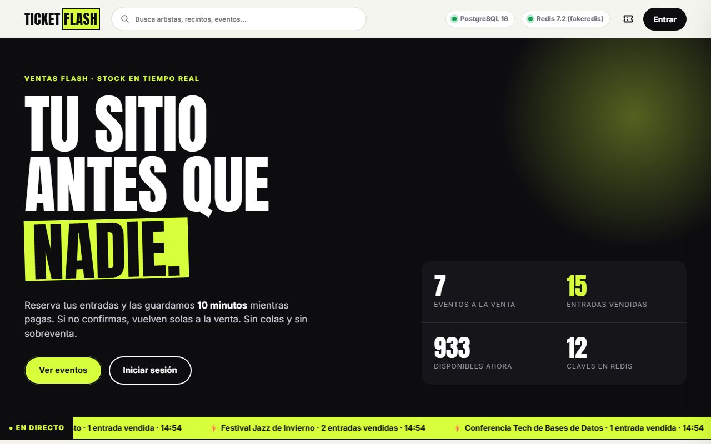
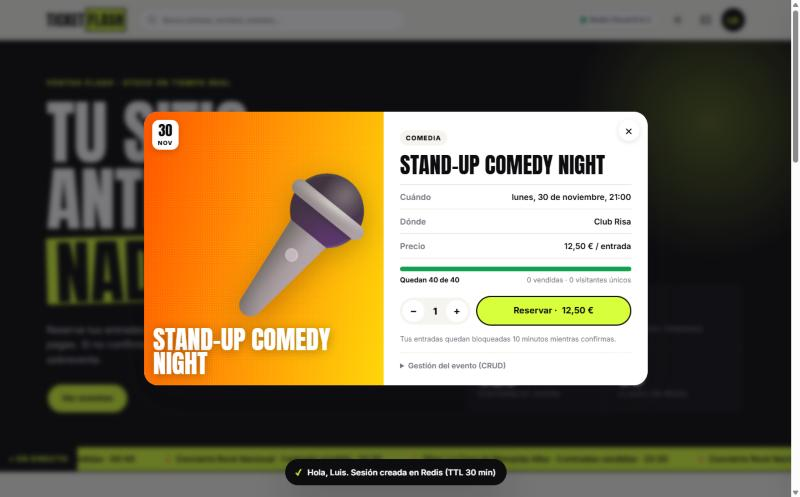
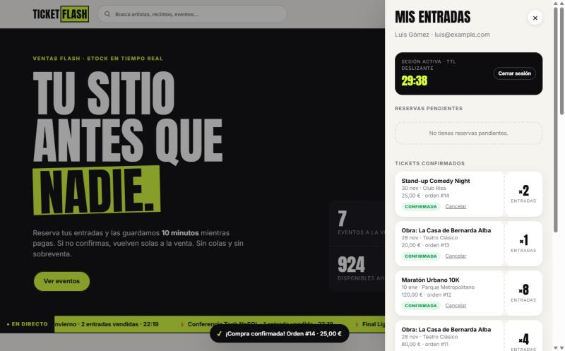

<div class="cover">
<p class="kicker">Desarrollo e Integración de Aplicaciones con Bases de Datos NoSQL en la Nube</p>
<h1 class="title">TicketFlash</h1>
<p class="subtitle">Venta de entradas con reservas temporales sobre Redis Cloud<br>Documentación de Diseño y Justificación — Modelo Clave-Valor</p>
<table class="meta">
<tr><td>Paradigma</td><td>Clave-Valor (Redis)</td></tr>
<tr><td>Servicio en la nube</td><td>Redis Cloud (Redis Ltd.) — plan Free, DBaaS administrado, AWS us-east-1, Redis 8.6</td></tr>
<tr><td>Lenguaje y SDK</td><td>Python 3.11+ · <code>redis-py</code> (driver oficial) · FastAPI · interfaz web HTML/JS</td></tr>
<tr><td>Aplicación en línea</td><td><code>https://ticketflash-xa9o.onrender.com</code> (Render, plan Free)</td></tr>
<tr><td>Repositorio</td><td><code>https://github.com/Otodeodo/ticketflash-redis</code></td></tr>
<tr><td>Autor</td><td>Alexander Pineda</td></tr>
<tr><td>Fecha</td><td>Noviembre de 2026</td></tr>
</table>
</div>

<div class="toc">
<h2>Contenido</h2>
<ol>
<li>Introducción y dominio del problema</li>
<li>Justificación del paradigma Clave-Valor frente al modelo relacional</li>
<li>Arquitectura de la solución</li>
<li>Diseño del modelo NoSQL</li>
<li>Catálogo de consultas</li>
<li>Consistencia, rendimiento y limitaciones</li>
<li>Conclusiones</li>
</ol>
</div>

## 1. Introducción y dominio del problema

**TicketFlash** es una taquilla en línea para eventos (conciertos, deportes, teatro). Su
reto característico aparece en las *ventas flash*: cuando se abre la venta de un evento
popular, miles de usuarios intentan comprar las mismas entradas en los mismos segundos.
El sistema debe garantizar que nunca se venda más de lo disponible, dejar que un usuario
"aparte" entradas unos minutos mientras paga, y liberarlas automáticamente si no completa
la compra.

El contexto funcional que cubre la aplicación es el siguiente:

* **Catálogo de eventos** con recinto, fecha, categoría, precio y capacidad (CRUD completo).
* **Usuarios** registrados e **inicio de sesión** con tokens que caducan por inactividad.
* **Stock en tiempo real**: cada evento mantiene un contador de entradas disponibles que se
  descuenta de forma atómica.
* **Reservas temporales (*holds*)**: una reserva bloquea *n* entradas durante 10 minutos.
  Si expira, el stock vuelve a estar disponible sin intervención manual.
* **Órdenes confirmadas**: una reserva vigente se convierte en una orden persistente, con
  historial por usuario.
* **Analítica instantánea**: ranking de eventos más vendidos, feed de actividad reciente y
  conteo de visitantes únicos por evento.
* **Caché** de resúmenes de evento con expiración corta para absorber picos de lectura.

La aplicación se entrega con tres puntos de entrada sobre la misma lógica: una **interfaz
web** para el usuario final (catálogo, sesión, reservas con cuenta atrás, compras, panel de
administración de eventos y analítica), una **API REST** documentada con Swagger y una
**CLI** para la demostración en terminal.

Estas necesidades son, en esencia, de **baja latencia, alta concurrencia sobre pocas claves
calientes y expiración automática de datos**: exactamente el perfil para el que fue diseñado
un almacén Clave-Valor en memoria como Redis.

## 2. Justificación del paradigma: Clave-Valor frente a SQL

### 2.1 Naturaleza del problema

Un SGBD relacional modela el dominio como tablas normalizadas y resuelve las lecturas con
`JOIN`s y las escrituras con transacciones ACID sobre disco. Es excelente para datos con
muchas relaciones y consultas *ad hoc*, pero el núcleo de TicketFlash no es relacional: son
**accesos directos por identificador** (evento 3, sesión *abc*, reserva 8) y **contadores
que cambian miles de veces por segundo**. Para cada operación crítica la aplicación ya conoce
la clave exacta; nunca necesita unir tablas ni filtrar por columnas arbitrarias.

### 2.2 Comparativa detallada

| Requisito | Modelo relacional (PostgreSQL / MySQL) | Clave-Valor (Redis Cloud) |
|---|---|---|
| **Descontar stock sin sobreventa** bajo miles de peticiones simultáneas | `UPDATE ... WHERE stock >= n` con bloqueo de fila; contención en la misma fila, *deadlocks* y escalado vertical. Latencia típica de milisegundos por ida y vuelta a disco. | `DECRBY` es atómico por diseño (Redis es monohilo para comandos). Un script Lua comprueba y descuenta en una sola operación sin bloqueos. Latencia sub-milisegundo en memoria. |
| **Reservas que caducan a los 10 minutos** | No existe expiración nativa: hace falta una columna `expires_at`, un *cron job* que borre filas y lógica para no contar reservas vencidas en cada consulta. | `EXPIRE` nativo por clave: Redis elimina la reserva sola. Un Sorted Set ordenado por instante de expiración permite devolver el stock en O(log N). |
| **Sesiones de usuario con caducidad deslizante** | Tabla de sesiones con limpieza periódica; cada petición hace `UPDATE last_seen`, generando escritura en disco y *bloat* de la tabla. | `HSET` + `EXPIRE` por token; renovar el TTL es una operación O(1) en memoria. Es el uso canónico de Redis como *session store*. |
| **Ranking "más vendidos" en tiempo real** | `SELECT event_id, SUM(qty) ... GROUP BY ... ORDER BY` sobre la tabla de órdenes, o una vista materializada que se refresca con retraso. Coste O(N) por consulta. | `ZINCRBY` al confirmar y `ZREVRANGE` para leer el top-k: O(log N) por actualización y O(log N + k) por lectura, siempre al día. |
| **Visitantes únicos por evento** | `COUNT(DISTINCT visitor)` sobre una tabla de visitas que crece sin límite. | HyperLogLog (`PFADD` / `PFCOUNT`): 12 KB por evento con error ≈ 0,8 %, independiente del número de visitas. |
| **Caché de lecturas calientes** | Requiere añadir Redis u otra caché externa de todos modos. | La propia base es la caché: `SET ... EX 60` con invalidación explícita. |
| **Esquema** | Rígido; alterar columnas en una tabla de millones de filas implica migraciones. | Cada valor es libre (un Hash puede ganar campos). El "esquema" vive en la convención de claves. |
| **Consultas analíticas ad hoc / integridad referencial** | Fortaleza: `JOIN`, claves foráneas, agregaciones arbitrarias. | Debilidad: hay que modelar cada patrón de acceso con una estructura; no hay claves foráneas (la app mantiene índices secundarios). |

### 2.3 Por qué Clave-Valor y no otro NoSQL

* Frente a un **grafo**, el dominio no tiene recorridos ni relaciones de profundidad
  variable: usuario → orden → evento es un camino fijo de longitud 1 que se resuelve con
  una clave.
* Frente a un **documental**, no necesitamos consultas por campos internos del documento;
  necesitamos primitivas atómicas (contadores, conjuntos ordenados, expiración) que el
  modelo documental no ofrece de forma nativa.
* Redis aporta además **estructuras de datos ricas** (Hash, Set, Sorted Set, List, HLL),
  por lo que el modelo "clave-valor" no se limita a cadenas: cada clave apunta a la
  estructura adecuada para su patrón de acceso.

### 2.4 Qué se sacrifica y cómo se mitiga

El modelo Clave-Valor renuncia a *joins* e integridad referencial. En TicketFlash se mitiga
con: (a) índices secundarios mantenidos por la aplicación (Sets de ids por categoría),
(b) scripts Lua y pipelines `MULTI/EXEC` para que las escrituras multi-clave sean atómicas, y
(c) un módulo central de nombres de clave (`app/keys.py`) que hace de "esquema" documentado.
Los datos de negocio que deben sobrevivir (órdenes, eventos, usuarios) no llevan TTL, de
modo que Redis actúa como base primaria y no solo como caché; en un plan de pago se añade
persistencia AOF en disco (ver 4.4).

## 3. Arquitectura de la solución

<figure>
<svg viewBox="0 0 900 420" xmlns="http://www.w3.org/2000/svg" font-family="Segoe UI, Arial, sans-serif" font-size="13">
  <defs>
    <marker id="arr" markerWidth="10" markerHeight="10" refX="9" refY="5" orient="auto"><path d="M0,0 L10,5 L0,10 z" fill="#374151"/></marker>
  </defs>
  <!-- Cliente -->
  <rect x="20" y="40" width="190" height="340" rx="10" fill="#eef2ff" stroke="#4f46e5" stroke-width="1.5"/>
  <text x="115" y="65" text-anchor="middle" font-weight="bold" fill="#312e81">CLIENTE</text>
  <rect x="40" y="90" width="150" height="60" rx="6" fill="#fff" stroke="#6366f1"/>
  <text x="115" y="115" text-anchor="middle">Aplicación web</text>
  <text x="115" y="133" text-anchor="middle" fill="#6b7280" font-size="11">HTML/CSS/JS · fetch JSON</text>
  <rect x="40" y="170" width="150" height="60" rx="6" fill="#fff" stroke="#6366f1"/>
  <text x="115" y="195" text-anchor="middle">CLI / Swagger UI</text>
  <text x="115" y="213" text-anchor="middle" fill="#6b7280" font-size="11">python -m app.cli · /docs</text>
  <rect x="40" y="250" width="150" height="60" rx="6" fill="#fff" stroke="#6366f1"/>
  <text x="115" y="275" text-anchor="middle">Pruebas (pytest)</text>
  <text x="115" y="293" text-anchor="middle" fill="#6b7280" font-size="11">fakeredis + Lua</text>

  <!-- Backend -->
  <rect x="270" y="40" width="330" height="340" rx="10" fill="#ecfdf5" stroke="#059669" stroke-width="1.5"/>
  <text x="435" y="65" text-anchor="middle" font-weight="bold" fill="#064e3b">BACKEND PYTHON (FastAPI) · Render</text>
  <rect x="290" y="85" width="290" height="46" rx="6" fill="#fff" stroke="#10b981"/>
  <text x="435" y="105" text-anchor="middle">app/api.py · app/cli.py · app/static/</text>
  <text x="435" y="122" text-anchor="middle" fill="#6b7280" font-size="11">rutas REST, validación Pydantic, sirve la interfaz web</text>
  <rect x="290" y="145" width="290" height="92" rx="6" fill="#fff" stroke="#10b981"/>
  <text x="435" y="165" text-anchor="middle">app/repositories/*</text>
  <text x="435" y="183" text-anchor="middle" fill="#6b7280" font-size="11">events · users · sessions · holds · orders · analytics</text>
  <text x="435" y="201" text-anchor="middle" fill="#6b7280" font-size="11">pipelines MULTI/EXEC · scripts Lua (EVALSHA)</text>
  <text x="435" y="219" text-anchor="middle" fill="#6b7280" font-size="11">app/keys.py (namespaces) · app/config.py (.env)</text>
  <rect x="290" y="252" width="290" height="46" rx="6" fill="#fff" stroke="#10b981"/>
  <text x="435" y="272" text-anchor="middle">SDK oficial redis-py (app/db.py)</text>
  <text x="435" y="289" text-anchor="middle" fill="#6b7280" font-size="11">pool de conexiones · RESP · register_script</text>
  <rect x="290" y="313" width="290" height="46" rx="6" fill="#fff" stroke="#10b981" stroke-dasharray="4 3"/>
  <text x="435" y="333" text-anchor="middle">scripts/seed.py</text>
  <text x="435" y="350" text-anchor="middle" fill="#6b7280" font-size="11">datos iniciales · limpieza con SCAN + DEL</text>

  <!-- Cloud -->
  <rect x="660" y="40" width="220" height="340" rx="10" fill="#fef2f2" stroke="#dc2626" stroke-width="1.5"/>
  <text x="770" y="65" text-anchor="middle" font-weight="bold" fill="#7f1d1d">REDIS CLOUD (DBaaS)</text>
  <rect x="680" y="90" width="180" height="130" rx="6" fill="#fff" stroke="#ef4444"/>
  <text x="770" y="112" text-anchor="middle">Instancia Redis 7.x</text>
  <text x="770" y="132" text-anchor="middle" fill="#6b7280" font-size="11">Plan Free · 30 MB</text>
  <text x="770" y="150" text-anchor="middle" fill="#6b7280" font-size="11">AWS / GCP, región elegida</text>
  <text x="770" y="168" text-anchor="middle" fill="#6b7280" font-size="11">Persistencia RDB/AOF (planes de pago)</text>
  <text x="770" y="186" text-anchor="middle" fill="#6b7280" font-size="11">Autenticación ACL (usuario default)</text>
  <text x="770" y="204" text-anchor="middle" fill="#6b7280" font-size="11">TLS opcional (rediss://)</text>
  <rect x="680" y="240" width="180" height="120" rx="6" fill="#fff" stroke="#ef4444"/>
  <text x="770" y="262" text-anchor="middle">Estructuras usadas</text>
  <text x="770" y="282" text-anchor="middle" fill="#6b7280" font-size="11">HASH · STRING (contadores)</text>
  <text x="770" y="300" text-anchor="middle" fill="#6b7280" font-size="11">SET · SORTED SET · LIST</text>
  <text x="770" y="318" text-anchor="middle" fill="#6b7280" font-size="11">HyperLogLog · TTL / EXPIRE</text>
  <text x="770" y="336" text-anchor="middle" fill="#6b7280" font-size="11">Scripts Lua</text>

  <!-- flechas -->
  <line x1="210" y1="120" x2="268" y2="120" stroke="#374151" stroke-width="1.5" marker-end="url(#arr)"/>
  <line x1="210" y1="200" x2="268" y2="200" stroke="#374151" stroke-width="1.5" marker-end="url(#arr)"/>
  <line x1="210" y1="280" x2="268" y2="280" stroke="#374151" stroke-width="1.5" marker-end="url(#arr)"/>
  <line x1="600" y1="200" x2="658" y2="200" stroke="#374151" stroke-width="1.5" marker-end="url(#arr)"/>
  <text x="629" y="190" text-anchor="middle" font-size="10" fill="#374151">RESP / TCP</text>
  <text x="629" y="215" text-anchor="middle" font-size="10" fill="#374151">(Internet)</text>
  <text x="450" y="405" text-anchor="middle" font-size="11" fill="#6b7280">Credenciales: variables de entorno (.env) → app/config.py → redis.Redis.from_url(REDIS_URL)</text>
</svg>
<figcaption>Figura 1. Diagrama de bloques: cliente, backend con el SDK de conexión y base de datos en la nube.</figcaption>
</figure>

**Flujo de una petición.** La interfaz web (servida por FastAPI en `/`) llama con `fetch`
a la API REST; la CLI invoca directamente los repositorios. En ambos casos la ruta
valida la entrada con Pydantic (en la API) y delega en un repositorio. El repositorio construye las claves
con `app/keys.py` y ejecuta los comandos a través de un único cliente `redis.Redis`
(con *pool* de conexiones) creado en `app/db.py` a partir de la variable `REDIS_URL`. Las
operaciones multi-clave sensibles se envían como scripts Lua registrados (`EVALSHA`), de modo
que Redis Cloud las ejecuta de forma atómica. Ninguna credencial aparece en el código: se
cargan con `python-dotenv` desde `.env`, que está excluido del repositorio.

**Despliegue.** Tanto la base de datos como la aplicación están en la nube. Redis Cloud
(DBaaS) aloja la base y **Render** (PaaS, plan gratuito) ejecuta el backend FastAPI con la
interfaz web. El archivo `render.yaml` del repositorio describe el servicio: instala
`requirements.txt`, arranca `uvicorn app.api:app --host 0.0.0.0 --port $PORT` y comprueba
la salud del servicio en `/health`. La URL de Redis se configura en Render como variable
secreta (`REDIS_URL`), nunca en el código. Tras cada `git push` a la rama `main`, la
versión nueva se publica con *Manual Deploy* desde el panel de Render. La aplicación pública está en `https://ticketflash-xa9o.onrender.com`.

### 3.1 Interfaz de usuario

La interfaz web (`app/static/`) es una página única en HTML, CSS y JavaScript sin
frameworks, que consume la API REST con `fetch`. Su diseño toma como referencia
plataformas reales de venta de entradas. De **DICE** adopta la tipografía editorial en
mayúsculas condensadas, el fondo claro con tinta negra y un único color de acento. De
**Fever** adopta el buscador en la cabecera, los chips de categoría, el carrusel "Top" y las
tarjetas tipo póster.

<figure>

<figcaption>Figura 2. Inicio: titular, estadísticas en vivo leídas de Redis y ticker de actividad (LIST).</figcaption>
</figure>

<figure>

<figcaption>Figura 3. Catálogo con chips de categoría (SET por categoría), pósters por evento y stock en tiempo real.</figcaption>
</figure>

<figure>

<figcaption>Figura 4. Detalle del evento: selector de cantidad, reserva y acciones CRUD de gestión.</figcaption>
</figure>

<figure>

<figcaption>Figura 5. "Mis entradas": TTL de la sesión, reservas con cuenta atrás circular y tickets confirmados.</figcaption>
</figure>

Cada elemento de la interfaz corresponde a una operación concreta sobre Redis:

| Elemento de la interfaz | Operación en Redis |
|---|---|
| Indicador "Redis Cloud" y estadísticas del inicio | `PING`, `INFO`, `DBSIZE`, `SCAN` + `TYPE` |
| Ticker "En directo" | `LRANGE tf:activity 0 11` |
| Carrusel "Top ventas" | `ZREVRANGE tf:ranking:sales 0 4 WITHSCORES` |
| Chips de categoría y catálogo | `SMEMBERS tf:events` + pipeline `HGETALL` / `GET` stock / `ZSCORE` / `PFCOUNT` |
| Abrir un evento | `PFADD tf:event:<id>:visitors` (visitante único) |
| Entrar con un perfil | `HSET tf:session:<token>` + `EXPIRE 1800` |
| Botón "Reservar" | Script Lua: `DECRBY` stock + `HSET` + `EXPIRE 600` + `ZADD` |
| Cuenta atrás de la reserva | `TTL tf:hold:<id>`, resincronizada cada 10 s |
| "Confirmar compra" | Script Lua: `DEL` reserva + `HSET` orden + `LPUSH` + `ZINCRBY` + `LTRIM` |
| "Soltar" reserva / cancelar orden | Script Lua con `ZREM` + `INCRBY` / pipeline `MULTI`/`EXEC` |
| Crear, editar, +10 entradas, eliminar evento | `HSET` + `SADD` / `HSET` + `DEL` caché / `INCRBY` / `DEL` + `SREM` + `ZREM` |
| "Cerrar sesión" | `DEL tf:session:<token>` |

## 4. Diseño del modelo NoSQL

### 4.1 Convención de nombres de claves (key namespaces)

Todas las claves siguen el patrón `<prefijo>:<entidad>:<id>[:<sub-recurso>]`, con prefijo
configurable (`KEY_PREFIX`, por defecto `tf`). El prefijo permite compartir una instancia con
otras aplicaciones y limpiar la base con `SCAN tf:*` sin tocar claves ajenas. Los separadores
`:` son la convención habitual de Redis y los reconocen las herramientas de inspección
(RedisInsight agrupa las claves por namespace).

| Clave | Tipo | Contenido | TTL |
|---|---|---|---|
| `tf:seq:<entidad>` | STRING | Contador `INCR` para generar ids (`event`, `user`, `hold`, `order`) | — |
| `tf:event:<id>` | HASH | `id, name, venue, date, category, price, capacity` | — |
| `tf:event:<id>:stock` | STRING (entero) | Entradas disponibles; modificado solo con `DECRBY`/`INCRBY` | — |
| `tf:event:<id>:visitors` | HyperLogLog | Visitantes únicos aproximados | — |
| `tf:events` | SET | Índice primario de ids de evento | — |
| `tf:events:category:<cat>` | SET | Índice secundario por categoría | — |
| `tf:cache:event:<id>:summary` | STRING (JSON) | Resumen cacheado (cache-aside) | 60 s |
| `tf:user:<id>` | HASH | `id, name, email, created_at` | — |
| `tf:users` | SET | Índice de ids de usuario | — |
| `tf:user:<id>:orders` | LIST | Ids de órdenes, más reciente primero (`LPUSH`) | — |
| `tf:user:<id>:holds` | SET | Reservas activas del usuario | — |
| `tf:session:<token>` | HASH | `user_id, created_at, last_seen` | 1800 s, deslizante |
| `tf:hold:<id>` | HASH | `id, user_id, event_id, qty, created_at, expires_at` | 600 s, fijo |
| `tf:holds:expiring` | SORTED SET | miembro `hold:event:user:qty`, score = *timestamp* de expiración | — |
| `tf:order:<id>` | HASH | `id, user_id, event_id, qty, unit_price, total, created_at, status` | — |
| `tf:orders` | SET | Índice de ids de orden | — |
| `tf:ranking:sales` | SORTED SET | miembro `event_id`, score = entradas vendidas | — |
| `tf:activity` | LIST | Últimas 100 entradas JSON de actividad (`LPUSH` + `LTRIM`) | — |

### 4.2 Estructuras de datos y por qué se eligió cada una

<figure>
<svg viewBox="0 0 900 470" xmlns="http://www.w3.org/2000/svg" font-family="Consolas, Menlo, monospace" font-size="12">
  <defs><marker id="a2" markerWidth="8" markerHeight="8" refX="7" refY="4" orient="auto"><path d="M0,0 L8,4 L0,8 z" fill="#6b7280"/></marker></defs>
  <!-- Event hash -->
  <rect x="20" y="20" width="250" height="120" rx="6" fill="#fff7ed" stroke="#ea580c"/>
  <text x="30" y="40" font-weight="bold" fill="#9a3412">HASH tf:event:3</text>
  <text x="30" y="60">name     "Final Liga de Baloncesto"</text>
  <text x="30" y="76">category "deporte"</text>
  <text x="30" y="92">price    "25.0"</text>
  <text x="30" y="108">capacity "150"</text>
  <text x="30" y="126">date     "2026-12-20T18:00"</text>
  <!-- stock -->
  <rect x="20" y="160" width="250" height="40" rx="6" fill="#fff7ed" stroke="#ea580c"/>
  <text x="30" y="178" font-weight="bold" fill="#9a3412">STRING tf:event:3:stock</text>
  <text x="30" y="194">"143"   ← DECRBY / INCRBY atómico</text>
  <!-- sets -->
  <rect x="20" y="220" width="250" height="56" rx="6" fill="#fff7ed" stroke="#ea580c"/>
  <text x="30" y="238" font-weight="bold" fill="#9a3412">SET tf:events:category:deporte</text>
  <text x="30" y="256">{ "3", "4" }</text>
  <text x="30" y="270" fill="#6b7280" font-size="11">índice secundario</text>
  <!-- HLL -->
  <rect x="20" y="296" width="250" height="40" rx="6" fill="#fff7ed" stroke="#ea580c"/>
  <text x="30" y="314" font-weight="bold" fill="#9a3412">HLL tf:event:3:visitors</text>
  <text x="30" y="330">PFCOUNT → 1 204  (≈12 KB)</text>

  <!-- hold -->
  <rect x="320" y="20" width="260" height="118" rx="6" fill="#eff6ff" stroke="#2563eb"/>
  <text x="330" y="40" font-weight="bold" fill="#1e3a8a">HASH tf:hold:8   TTL 600 s</text>
  <text x="330" y="60">user_id    "3"</text>
  <text x="330" y="76">event_id   "2"</text>
  <text x="330" y="92">qty        "2"</text>
  <text x="330" y="108">expires_at "1795400000"</text>
  <text x="330" y="126" fill="#6b7280" font-size="11">Redis la borra sola al vencer</text>
  <!-- zset expiring -->
  <rect x="320" y="160" width="260" height="76" rx="6" fill="#eff6ff" stroke="#2563eb"/>
  <text x="330" y="180" font-weight="bold" fill="#1e3a8a">ZSET tf:holds:expiring</text>
  <text x="330" y="200">score 1795400000 → "8:2:3:2"</text>
  <text x="330" y="216">score 1795400120 → "9:1:1:2"</text>
  <text x="330" y="230" fill="#6b7280" font-size="11">hold:event:user:qty — devuelve stock</text>
  <!-- session -->
  <rect x="320" y="256" width="260" height="80" rx="6" fill="#eff6ff" stroke="#2563eb"/>
  <text x="330" y="276" font-weight="bold" fill="#1e3a8a">HASH tf:session:W13Gh…  TTL 1800 s</text>
  <text x="330" y="296">user_id   "1"</text>
  <text x="330" y="312">last_seen "2026-11-16T10:02:11Z"</text>
  <text x="330" y="328" fill="#6b7280" font-size="11">cada acceso renueva el TTL (deslizante)</text>

  <!-- order -->
  <rect x="630" y="20" width="250" height="118" rx="6" fill="#f0fdf4" stroke="#16a34a"/>
  <text x="640" y="40" font-weight="bold" fill="#14532d">HASH tf:order:5   (sin TTL)</text>
  <text x="640" y="60">user_id  "4"   event_id "6"</text>
  <text x="640" y="76">qty      "1"   total    "50.0"</text>
  <text x="640" y="92">status   "CONFIRMED"</text>
  <text x="640" y="108">created_at "2026-11-16T…"</text>
  <!-- user orders list -->
  <rect x="630" y="160" width="250" height="56" rx="6" fill="#f0fdf4" stroke="#16a34a"/>
  <text x="640" y="180" font-weight="bold" fill="#14532d">LIST tf:user:4:orders</text>
  <text x="640" y="200">[ "5", "2" ]   ← LPUSH, LRANGE 0 19</text>
  <!-- ranking -->
  <rect x="630" y="236" width="250" height="76" rx="6" fill="#f0fdf4" stroke="#16a34a"/>
  <text x="640" y="256" font-weight="bold" fill="#14532d">ZSET tf:ranking:sales</text>
  <text x="640" y="276">score 7 → "3"    score 5 → "1"</text>
  <text x="640" y="292">score 2 → "2"    score 1 → "7"</text>
  <text x="640" y="306" fill="#6b7280" font-size="11">ZINCRBY al vender · ZREVRANGE top-k</text>
  <!-- activity -->
  <rect x="630" y="332" width="250" height="56" rx="6" fill="#f0fdf4" stroke="#16a34a"/>
  <text x="640" y="352" font-weight="bold" fill="#14532d">LIST tf:activity  (LTRIM 0 99)</text>
  <text x="640" y="372">[ {"type":"ORDER",…}, … ]</text>

  <!-- arrows -->
  <line x1="270" y1="180" x2="318" y2="190" stroke="#6b7280" stroke-width="1.2" marker-end="url(#a2)"/>
  <text x="294" y="172" font-size="10" fill="#6b7280" text-anchor="middle">Lua</text>
  <line x1="580" y1="80" x2="628" y2="80" stroke="#6b7280" stroke-width="1.2" marker-end="url(#a2)"/>
  <text x="604" y="70" font-size="10" fill="#6b7280" text-anchor="middle">confirmar</text>
  <line x1="580" y1="200" x2="628" y2="270" stroke="#6b7280" stroke-width="1.2" marker-end="url(#a2)"/>
  <text x="450" y="420" font-size="12" fill="#374151" font-family="Segoe UI, Arial" text-anchor="middle">Naranja: catálogo y stock · Azul: datos volátiles con TTL · Verde: datos persistentes y analítica</text>
</svg>
<figcaption>Figura 6. Estructuras de datos del modelo con valores de ejemplo tras ejecutar el seed.</figcaption>
</figure>

* **HASH para entidades** (evento, usuario, orden, reserva, sesión): permite leer o
  actualizar un campo (`HGET`, `HINCRBY`) sin deserializar todo el objeto, y Redis lo
  codifica de forma compacta (*listpack*) cuando tiene pocos campos.
* **STRING entero para el stock**: separado del Hash para poder usar `DECRBY`/`INCRBY`
  dentro de un script Lua y evitar escribir el objeto completo en cada venta.
* **SET para índices**: Redis no indexa campos; cada colección e índice secundario es un Set
  de ids (`SADD` al crear, `SREM` al borrar), con `SMEMBERS` para listar.
* **SORTED SET para ranking y cola de expiración**: la ordenación por *score* da el top-k y
  los rangos por tiempo en O(log N).
* **LIST para historiales**: `LPUSH` + `LRANGE` entrega "los últimos N" en O(N) y `LTRIM`
  acota la memoria del feed global.
* **HyperLogLog para visitantes únicos**: cardinalidad aproximada con memoria constante.
* **STRING JSON con `EX` para caché**: patrón *cache-aside* con invalidación al actualizar.

### 4.3 Estrategias de expiración (TTL)

| Dato | Estrategia | Detalle |
|---|---|---|
| Sesión | **TTL deslizante** | `EXPIRE 1800` en el login y en cada petición autenticada (`SessionRepository.touch`). Un usuario inactivo 30 min pierde la sesión sin tarea de limpieza. |
| Reserva temporal | **TTL fijo + cola ordenada** | `EXPIRE 600` sobre `tf:hold:<id>`; en paralelo `ZADD tf:holds:expiring <expira> hold:event:user:qty`. Como una clave expirada ya no se puede leer, el miembro del ZSET codifica los datos necesarios para devolver el stock. `reclaim_expired()` hace `ZRANGEBYSCORE -inf <ahora>` y libera cada reserva con un script Lua que usa `ZREM` como cerrojo (devuelve el stock una sola vez). Se invoca de forma perezosa antes de crear reservas y al listar pendientes, y también puede programarse. Esta técnica se eligió frente a *keyspace notifications* porque no depende de la configuración `notify-keyspace-events` del proveedor ni de un suscriptor permanentemente conectado. |
| Caché de resumen | **TTL corto + invalidación** | `SET key json EX 60`; `DEL` explícito al actualizar el evento o confirmar/cancelar órdenes, para no servir datos obsoletos. |
| Catálogo, usuarios, órdenes, ranking | **Sin TTL** | Datos de negocio: persistentes. |

### 4.4 Políticas de persistencia y consistencia

* **Persistencia**: Redis ofrece dos mecanismos, **RDB** (*snapshots* periódicos) y **AOF**
  (*Append Only File*, registro de cada escritura con `fsync` cada segundo). El plan Free de
  Redis Cloud usado en este proyecto **no incluye persistencia en disco** (la consola lo
  indica como "Data persistence: None"); los datos viven en memoria y se repoblan con
  `scripts/seed.py`. En un despliegue real se activaría el plan Essentials con *AOF every 1
  sec* (opción disponible en la misma consola), con lo que un reinicio perdería como máximo
  un segundo de escrituras y los datos sin TTL (órdenes, eventos, usuarios, ranking)
  actuarían como registro primario.
* **Atomicidad**: Redis ejecuta cada comando de forma atómica. Para operaciones que tocan
  varias claves se usan (a) **scripts Lua** (`EVALSHA`) cuando hay lógica condicional
  (comprobar stock antes de descontar, verificar que la reserva exista antes de confirmar) y
  (b) **pipelines transaccionales `MULTI/EXEC`** cuando solo hay que agrupar escrituras
  (crear evento, borrar usuario). Así no existe el instante en que el stock está descontado
  pero la reserva no está registrada, ni viceversa.
* **Consistencia**: con una única instancia primaria el modelo es fuertemente consistente
  para lecturas y escrituras sobre la misma clave (lectura tras escritura garantizada). Si
  se activaran réplicas de lectura, estas serían eventualmente consistentes.
* **Política de memoria**: la instancia está configurada con `maxmemory-policy =
  volatile-lru` (valor por defecto en Redis Cloud): si se agotaran los 30 MB, Redis solo
  desalojaría claves con TTL (sesiones, reservas, caché) y nunca datos de negocio.

## 5. Catálogo de consultas

Las consultas se muestran en dos formas: la llamada al SDK oficial `redis-py` tal como está en
el código y el comando Redis equivalente. Todas las claves se generan con `app/keys.py`.

### 5.1 Crear un evento (pipeline MULTI/EXEC)

```python
# app/repositories/events.py
event_id = str(self.r.incr(keys.seq("event")))              # INCR tf:seq:event
pipe = self.r.pipeline(transaction=True)                     # MULTI
pipe.hset(keys.event(event_id), mapping=data)                # HSET tf:event:3 name ... price ...
pipe.set(keys.event_stock(event_id), capacity)               # SET  tf:event:3:stock 150
pipe.sadd(keys.events_index(), event_id)                     # SADD tf:events 3
pipe.sadd(keys.events_by_category(category), event_id)       # SADD tf:events:category:deporte 3
pipe.execute()                                               # EXEC
```

### 5.2 Leer un evento con stock, ventas y visitantes (pipeline de lectura)

```python
pipe = self.r.pipeline(transaction=False)
pipe.hgetall(keys.event(event_id))                 # HGETALL tf:event:3
pipe.get(keys.event_stock(event_id))               # GET     tf:event:3:stock
pipe.zscore(keys.ranking_sales(), event_id)        # ZSCORE  tf:ranking:sales 3
pipe.pfcount(keys.event_visitors(event_id))        # PFCOUNT tf:event:3:visitors
raw, stock, sold, visitors = pipe.execute()
self.r.pfadd(keys.event_visitors(event_id), visitor_token)   # PFADD (visitante único)
```

### 5.3 Actualizar un evento e invalidar caché

```python
pipe = self.r.pipeline(transaction=True)
pipe.srem(keys.events_by_category(old_category), event_id)   # SREM índice antiguo
pipe.sadd(keys.events_by_category(new_category), event_id)   # SADD índice nuevo
pipe.hset(keys.event(event_id), mapping={"name": ..., "category": ...})  # HSET
pipe.delete(keys.event_summary_cache(event_id))              # DEL tf:cache:event:3:summary
pipe.execute()
```

### 5.4 Eliminar un evento (limpieza de claves e índices)

```python
pipe = self.r.pipeline(transaction=True)
pipe.delete(keys.event(event_id), keys.event_stock(event_id),
            keys.event_visitors(event_id), keys.event_summary_cache(event_id))  # DEL k1 k2 k3 k4
pipe.srem(keys.events_index(), event_id)                     # SREM tf:events 3
pipe.srem(keys.events_by_category(category), event_id)       # SREM tf:events:category:deporte 3
pipe.zrem(keys.ranking_sales(), event_id)                    # ZREM tf:ranking:sales 3
pipe.execute()
```

### 5.5 Listar por categoría (índice secundario con SET)

```python
ids = self.r.smembers(keys.events_by_category("deporte"))   # SMEMBERS tf:events:category:deporte
```

### 5.6 Sesión con TTL deslizante

```python
# login
pipe = self.r.pipeline(transaction=True)
pipe.hset(keys.session(token), mapping={"user_id": user_id, "created_at": now})  # HSET
pipe.expire(keys.session(token), settings.session_ttl)       # EXPIRE tf:session:<token> 1800
pipe.execute()

# cada petición autenticada: validar y renovar
data = self.r.hgetall(keys.session(token))                   # HGETALL
self.r.expire(keys.session(token), settings.session_ttl)     # EXPIRE (renueva el TTL)
ttl = self.r.ttl(keys.session(token))                        # TTL
self.r.delete(keys.session(token))                           # DEL (logout)
```

### 5.7 Crear una reserva temporal (script Lua atómico)

```python
# app/db.py — registrado una vez; redis-py lo invoca con EVALSHA
LUA_CREATE_HOLD = """
local stock = tonumber(redis.call('GET', KEYS[1]) or '0')
local qty = tonumber(ARGV[4])
if qty <= 0 or stock < qty then return {0, stock} end
local expires_at = tonumber(ARGV[6]) + tonumber(ARGV[5])
redis.call('DECRBY', KEYS[1], qty)
redis.call('HSET', KEYS[2], 'id', ARGV[1], 'user_id', ARGV[2], 'event_id', ARGV[3],
           'qty', ARGV[4], 'created_at', ARGV[8], 'expires_at', tostring(expires_at))
redis.call('EXPIRE', KEYS[2], tonumber(ARGV[5]))
redis.call('ZADD', KEYS[3], expires_at, ARGV[7])
redis.call('SADD', KEYS[4], ARGV[1])
return {1, stock - qty}
"""

# app/repositories/holds.py
ok, remaining = self.db.create_hold(
    keys=[keys.event_stock(event_id), keys.hold(hold_id),
          keys.holds_expiring(), keys.user_holds(user_id)],
    args=[hold_id, user_id, event_id, qty, settings.hold_ttl, now_ts(),
          keys.hold_member(hold_id, event_id, user_id, qty), now_iso()],
)
if int(ok) != 1:
    raise ConflictError(f"Stock insuficiente: quedan {remaining} entradas")
```

Equivalente en `redis-cli`: `EVALSHA <sha> 4 tf:event:2:stock tf:hold:8 tf:holds:expiring tf:user:3:holds 8 3 2 2 600 1795399400 8:2:3:2 2026-11-16T10:00:00Z`.

### 5.8 Liberar reservas expiradas (ZRANGEBYSCORE + Lua con cerrojo)

```python
LUA_RELEASE_HOLD = """
if redis.call('ZREM', KEYS[2], ARGV[1]) == 0 then return 0 end   -- solo uno libera
redis.call('INCRBY', KEYS[3], tonumber(ARGV[3]))                 -- devolver stock
redis.call('DEL', KEYS[1])
redis.call('SREM', KEYS[4], ARGV[2])
return 1
"""

expired = self.r.zrangebyscore(keys.holds_expiring(), "-inf", now_ts())  # ZRANGEBYSCORE ... -inf <now>
for member in expired:
    hold_id, event_id, user_id, qty = keys.parse_hold_member(member)
    self.db.release_hold(keys=[keys.hold(hold_id), keys.holds_expiring(),
                               keys.event_stock(event_id), keys.user_holds(user_id)],
                         args=[member, hold_id, qty])
```

### 5.9 Confirmar reserva → orden, ranking y feed (script Lua atómico)

```python
LUA_CONFIRM_HOLD = """
if redis.call('EXISTS', KEYS[1]) == 0 then return {0} end
if redis.call('ZREM', KEYS[2], ARGV[1]) == 0 then return {0} end
local h = redis.call('HMGET', KEYS[1], 'user_id', 'event_id', 'qty')
local user_id, event_id, qty = h[1], h[2], tonumber(h[3])
local total = qty * tonumber(ARGV[4])
redis.call('DEL', KEYS[1])                                   -- borrar reserva
redis.call('SREM', KEYS[3], ARGV[2])
redis.call('HSET', KEYS[4], 'id', ARGV[3], 'user_id', user_id, 'event_id', event_id,
           'qty', tostring(qty), 'unit_price', ARGV[4], 'total', tostring(total),
           'created_at', ARGV[5], 'status', 'CONFIRMED')     -- crear orden
redis.call('SADD', KEYS[5], ARGV[3])                         -- índice de órdenes
redis.call('LPUSH', KEYS[6], ARGV[3])                        -- historial del usuario
redis.call('ZINCRBY', KEYS[7], qty, event_id)                -- ranking de ventas
redis.call('LPUSH', KEYS[8], ARGV[6])                        -- feed de actividad
redis.call('LTRIM', KEYS[8], 0, tonumber(ARGV[7]) - 1)       -- acotar a 100
return {1, event_id, qty, tostring(total)}
"""
```

### 5.10 Ranking de eventos más vendidos (SORTED SET)

```python
rows = self.r.zrevrange(keys.ranking_sales(), 0, limit - 1, withscores=True)
# ZREVRANGE tf:ranking:sales 0 4 WITHSCORES
rank = self.r.zrevrank(keys.ranking_sales(), event_id)       # ZREVRANK (posición de un evento)
```

### 5.11 Historial y feed (LIST)

```python
ids = self.r.lrange(keys.user_orders(user_id), 0, 19)        # LRANGE tf:user:1:orders 0 19
feed = self.r.lrange(keys.activity(), 0, 9)                  # LRANGE tf:activity 0 9
```

### 5.12 Caché cache-aside con expiración

```python
cached = self.r.get(cache_key)                               # GET tf:cache:event:3:summary
if cached:
    return json.loads(cached), True                          # hit
self.r.set(cache_key, json.dumps(summary), ex=settings.cache_ttl)   # SET ... EX 60
```

### 5.13 Mantenimiento: limpieza por namespace (seed --reset)

```python
for key in db.client.scan_iter(match="tf:*", count=500):     # SCAN 0 MATCH tf:* COUNT 500
    batch.append(key)
db.client.delete(*batch)                                     # DEL k1 k2 ... (nunca FLUSHDB)
```

## 6. Consistencia, rendimiento y limitaciones

**Rendimiento.** Todas las operaciones del camino crítico son O(1) u O(log N) y se resuelven
en memoria; la latencia dominante es la red hacia Redis Cloud (decenas de milisegundos entre
regiones). Por ello las lecturas compuestas usan *pipelines* (una sola ida y vuelta para 4
comandos) y las escrituras compuestas usan Lua (una sola ida y vuelta y sin bloqueos).
`register_script` cachea el SHA del script y usa `EVALSHA`, enviando el código solo la
primera vez.

**Concurrencia.** Como Redis procesa los comandos en un solo hilo, dos clientes que ejecutan
el script de reserva sobre el mismo evento nunca se intercalan: el segundo ve el stock ya
descontado por el primero. No hace falta `WATCH` ni bloqueos optimistas.

**Manejo de credenciales y conexión.** `app/config.py` lee `REDIS_URL` (o host, puerto,
usuario y contraseña) del entorno; `redis-py` gestiona un *pool* con reconexión y *timeouts*
de 5 s. Redis Cloud autentica con ACL (usuario `default` + contraseña) y admite TLS mediante
el esquema `rediss://` sin cambiar código.

**Limitaciones conocidas.** (1) La expiración de reservas es *perezosa*: el stock de una
reserva vencida se devuelve en la siguiente operación que invoque `reclaim_expired()`; en
producción se añadiría un trabajador periódico. (2) No hay consultas por campos arbitrarios:
cada nuevo filtro exige un índice (Set) mantenido por la aplicación, o el módulo RediSearch.
(3) El plan gratuito ofrece una única instancia sin réplica ni persistencia, con un límite de
30 conexiones y 100 operaciones por segundo, suficiente para la demostración pero no para
producción.

## 7. Conclusiones

El dominio de la venta de entradas con reservas temporales se caracteriza por accesos por
clave, contadores de alta concurrencia y datos que deben caducar solos. Estas tres
propiedades coinciden con las primitivas nativas de Redis (comandos atómicos, estructuras
especializadas y `EXPIRE`), que un SGBD relacional solo puede emular con bloqueos,
tareas de limpieza y mayor latencia. El modelo diseñado usa el tipo de estructura adecuado
para cada patrón de acceso, mantiene la atomicidad de las operaciones multi-clave con scripts
Lua y pipelines, documenta el esquema en una convención de claves centralizada y aísla las
credenciales en variables de entorno. La aplicación resultante ejecuta el ciclo completo
(CRUD, sesiones con TTL deslizante, reservas con TTL fijo, ranking, caché e historial) contra
una instancia administrada de Redis Cloud.
