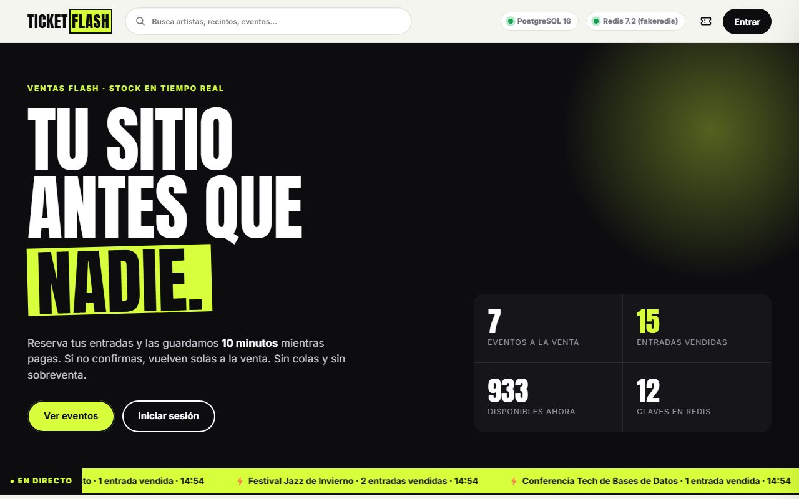
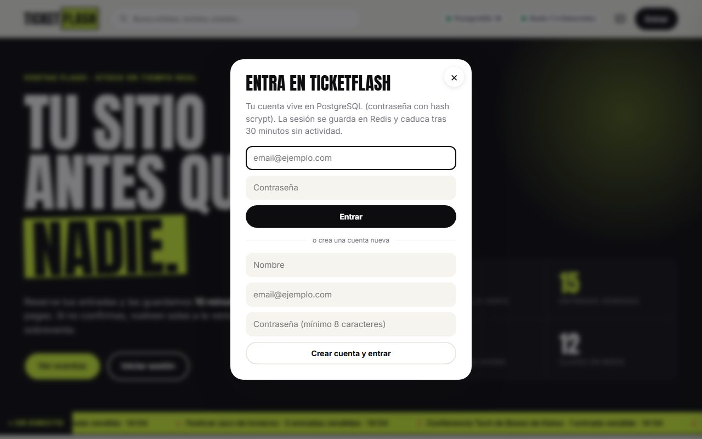
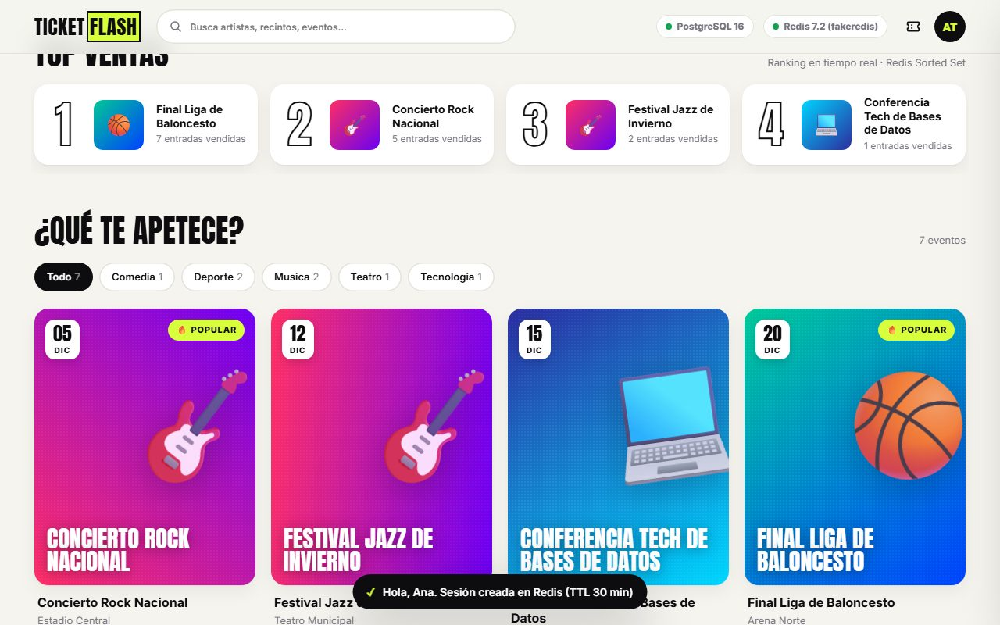
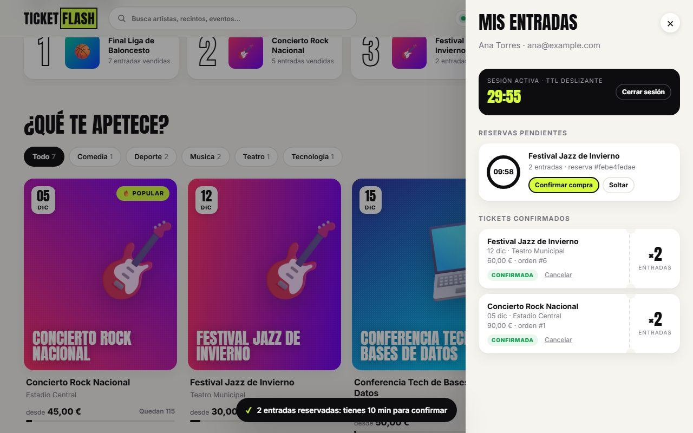
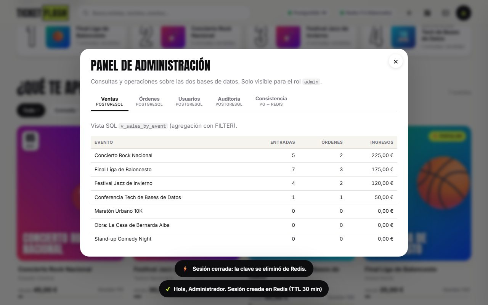
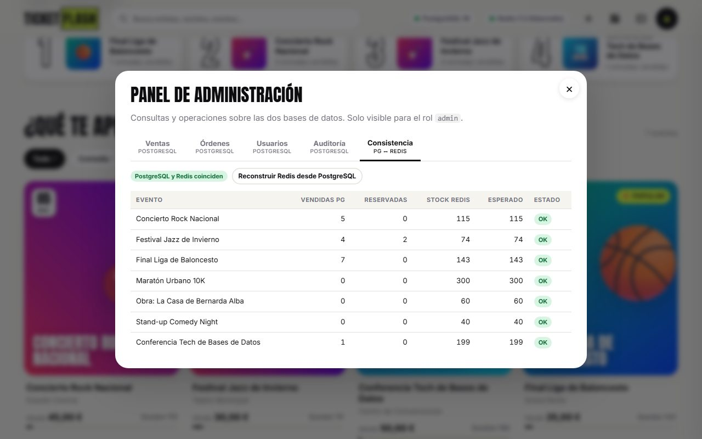

<div class="cover">
<div class="cover-top">
<span class="brand">TICKET<span>FLASH</span></span>
<span class="course">Bases de Datos Avanzadas · Proyecto final</span>
</div>
<div class="cover-main">
<p class="kicker">Documentación y diseño</p>
<h1 class="title">TICKET<br>FLASH<mark>.</mark></h1>
<p class="subtitle">Sistema de venta de entradas sobre dos bases de datos: PostgreSQL (relacional) y Redis (no relacional), con transacciones, concurrencia, seguridad y respaldo remoto.</p>
</div>
<div class="cover-grid">
<div><small>Relacional</small><b>PostgreSQL 16/17 · Neon</b></div>
<div><small>No relacional</small><b>Redis · Redis Cloud</b></div>
<div><small>Lenguaje</small><b>Python 3.12 · FastAPI</b></div>
<div><small>Despliegue</small><b>Render (PaaS)</b></div>
</div>
<div class="cover-foot">
<div><small>Autor</small><b>Alexander Pineda</b></div>
<div><small>Profesor</small><b>Fernando de Jesús Martínez Chacón</b></div>
<div><small>Fecha</small><b>Noviembre de 2026</b></div>
<div><small>Código</small><b>github.com/Otodeodo/ticketflash-redis</b></div>
</div>
</div>

<div class="toc">
<p class="kicker dark">Índice</p>
<h2 class="toc-title">Contenido</h2>
<ol>
<li><span>01</span>Contexto, reglas de negocio y necesidades de información</li>
<li><span>02</span>Tecnología utilizada</li>
<li><span>03</span>Referencias de descarga y manuales</li>
<li><span>04</span>Diseño de las bases de datos y control de concurrencia</li>
<li><span>05</span>Diccionario de datos</li>
<li><span>06</span>Diseño y justificación del respaldo remoto</li>
<li><span>07</span>Manual de usuario</li>
</ol>
</div>

## 1. Contexto, reglas de negocio y necesidades de información

### 1.1 Contexto

**TicketFlash** es una taquilla en línea de eventos (conciertos, deporte, teatro, comedia). Su
reto característico son las *ventas flash*: al abrirse la venta de un evento popular, miles de
usuarios intentan comprar las mismas entradas en los mismos segundos. El sistema debe garantizar
que **nunca se vende más de lo disponible**, permitir que el comprador "aparte" entradas unos
minutos mientras paga y liberarlas solas si no completa la compra, y conservar un registro
contable e inalterable de cada venta.

Ese problema reúne dos tipos de datos con necesidades opuestas, y por eso el sistema usa **dos
bases de datos** con responsabilidades distintas:

| | PostgreSQL (relacional) | Redis (no relacional, clave-valor) |
|---|---|---|
| Qué guarda | Lo que debe **sobrevivir y ser exacto**: usuarios, eventos, órdenes, auditoría | Lo que debe ser **rápido y puede caducar**: stock en caliente, reservas, sesiones, ranking, caché |
| Garantía principal | ACID, integridad referencial, restricciones | Atomicidad por operación/script, TTL nativo, latencia de microsegundos |
| Si se pierde | Es una pérdida de datos del negocio (se protege con respaldo) | Se **reconstruye** desde PostgreSQL (`reconcile`) |

### 1.2 Reglas de negocio

| Id | Regla | Dónde se hace cumplir |
|---|---|---|
| RN-01 | Nunca se venden más entradas que la capacidad del evento (**no sobreventa**). | Redis: script Lua atómico. PostgreSQL: `UPDATE ... WHERE sold + qty <= capacity` y `CHECK (sold <= capacity)` |
| RN-02 | Una reserva bloquea entradas **10 minutos**; si no se confirma, expira y el stock vuelve a la venta. | Redis: `EXPIRE` + ZSET de expiración |
| RN-03 | Una compra admite de 1 a 10 entradas. | `CHECK (qty BETWEEN 1 AND 10)` y validación Pydantic |
| RN-04 | Cada reserva se convierte, como máximo, en **una** orden (idempotencia). | Redis: `ZREM` como cerrojo. PostgreSQL: índice único parcial `ux_orders_hold` |
| RN-05 | Las órdenes son un registro contable: no se borran ni se modifican; solo pueden **cancelarse**, lo que devuelve el stock. | El rol de la app no tiene `DELETE` en `orders` y solo `UPDATE (status, cancelled_at)` |
| RN-06 | Un evento o usuario con órdenes no se puede eliminar. | `FOREIGN KEY ... ON DELETE RESTRICT` |
| RN-07 | La capacidad nunca puede ser menor que lo ya vendido; precio y capacidad son positivos. | `CHECK` en `events` |
| RN-08 | Existen dos roles de aplicación: **cliente** (reserva, compra, cancela lo suyo) y **administrador** (gestiona eventos, usuarios, informes). | Sesión en Redis (`role`) + dependencias de la API |
| RN-09 | Las contraseñas tienen mínimo 8 caracteres y se guardan con hash `scrypt` y sal; tras 5 intentos fallidos el acceso se bloquea 5 minutos. | `app/security.py`, contador en Redis |
| RN-10 | La sesión caduca tras 30 minutos **sin actividad** (expiración deslizante). | Redis: `EXPIRE` renovado en cada petición |
| RN-11 | Cada venta, cancelación, cambio de precio o borrado de evento queda en una **bitácora de auditoría** que la aplicación no puede alterar. | Triggers `SECURITY DEFINER` sobre `audit_log` |
| RN-12 | Un usuario solo ve y modifica sus propias reservas y órdenes. | Comprobaciones de propiedad en repositorios y API |

### 1.3 Necesidades de información

Las preguntas que el sistema debe responder determinan en qué base vive cada dato:

| Necesidad | Consumidor | Fuente |
|---|---|---|
| ¿Cuántas entradas quedan del evento X **ahora mismo**? | Comprador | Redis (`GET` stock) |
| ¿Qué reservas vencen primero? ¿cuánto falta para que expire la mía? | Comprador / sistema | Redis (ZSET + `TTL`) |
| ¿Quién es este usuario y qué rol tiene? ¿sigue vigente su sesión? | API | PostgreSQL (alta) + Redis (sesión) |
| Catálogo de eventos filtrado por categoría y ordenado por fecha | Comprador | PostgreSQL (índice) + stock de Redis |
| Historial de compras de un usuario | Comprador | PostgreSQL (índice `user_id, created_at`) |
| Top de eventos más vendidos y actividad reciente | Portada | Redis (ZSET y LIST) |
| Ventas e **ingresos** por evento | Administrador | PostgreSQL (vista agregada) |
| ¿Quién cambió qué y cuándo? | Administrador | PostgreSQL (`audit_log`) |
| ¿Coinciden PostgreSQL y Redis? | Administrador | Consulta cruzada (`/admin/consistency`) |
| ¿Cuántos visitantes distintos vieron cada evento? | Administrador | Redis (HyperLogLog) |

## 2. Tecnología utilizada

| Capa | Tecnología | Versión | Para qué se usa |
|---|---|---|---|
| Base relacional | **PostgreSQL** (servicio gestionado **Neon**) | 16 / 17 | Datos permanentes, transacciones ACID, roles y privilegios, triggers, vistas |
| Base no relacional | **Redis** (servicio gestionado **Redis Cloud**) | 7.x / 8.x | Modelo clave-valor: STRING, HASH, SET, ZSET, LIST, HyperLogLog, TTL, scripts Lua |
| Lenguaje | **Python** | 3.12 | Lógica de negocio, API, CLI, scripts de respaldo |
| Driver PostgreSQL | **psycopg 3** + `psycopg_pool` | 3.2+ | Pool de conexiones y transacciones |
| Driver Redis | **redis-py** | 5+ | Cliente oficial, pipelines y `register_script` |
| API y web | **FastAPI** + Uvicorn; interfaz HTML/CSS/JS | 0.110+ | API REST, validación Pydantic, sirve la interfaz |
| Respaldo | `pg_dump` / `pg_restore`, `DUMP`/`RESTORE` de Redis, `rclone` o S3 | — | Respaldo y restauración remotos |
| Pruebas | `pytest`, `fakeredis`, `pgserver` (PostgreSQL real embebido) | — | 49 pruebas automáticas contra un PostgreSQL real |
| Despliegue | **Render** (PaaS) + `docker-compose` para entorno local | — | Aplicación en línea y laboratorio reproducible |

**Por qué estas dos bases.** PostgreSQL es el estándar para datos transaccionales: integridad
referencial, `CHECK`, bloqueo de filas, triggers y un modelo de privilegios fino. Redis aporta
justo lo que PostgreSQL hace peor: contadores atómicos de latencia mínima, expiración automática
(TTL) y estructuras como los conjuntos ordenados para rankings. Python se eligió por el soporte
de primera clase de ambos drivers y porque permite escribir la capa de repositorios con poco código.

**Interfaz de usuario.** Aplicación web (HTML/CSS/JS) servida por la propia API y consola
(`python -m app.cli`). Desde ellas se consultan y actualizan **las dos bases**: el catálogo y las
reservas combinan datos de ambas, y el panel de administración opera sobre PostgreSQL y sobre la
consistencia con Redis.

## 3. Referencias de descarga y manuales

| Tecnología | Descarga / sitio | Manual |
|---|---|---|
| PostgreSQL | <https://www.postgresql.org/download/> | <https://www.postgresql.org/docs/16/index.html> |
| Neon (PostgreSQL gestionado) | <https://neon.tech> | <https://neon.tech/docs> |
| Redis | <https://redis.io/downloads/> | <https://redis.io/docs/latest/> |
| Redis Cloud | <https://redis.io/try-free/> | <https://redis.io/docs/latest/operate/rc/> |
| Redis ACL (usuarios y permisos) | — | <https://redis.io/docs/latest/operate/oss_and_stack/management/security/acl/> |
| Python | <https://www.python.org/downloads/> | <https://docs.python.org/3/> |
| psycopg 3 | <https://pypi.org/project/psycopg/> | <https://www.psycopg.org/psycopg3/docs/> |
| redis-py | <https://pypi.org/project/redis/> | <https://redis-py.readthedocs.io/> |
| FastAPI | <https://pypi.org/project/fastapi/> | <https://fastapi.tiangolo.com/> |
| Docker Desktop | <https://www.docker.com/products/docker-desktop/> | <https://docs.docker.com/> |
| rclone (respaldo a Drive/S3) | <https://rclone.org/downloads/> | <https://rclone.org/docs/> |
| Render | <https://render.com> | <https://render.com/docs> |

Código fuente y despliegue: <https://github.com/Otodeodo/ticketflash-redis> ·
aplicación en línea: <https://ticketflash-xa9o.onrender.com> · API (Swagger): `/docs`.

## 4. Diseño de las bases de datos y control de concurrencia

### 4.1 Arquitectura

<figure>
<svg viewBox="0 0 900 380" xmlns="http://www.w3.org/2000/svg" font-family="Segoe UI, Arial, sans-serif" font-size="13">
  <defs><marker id="a1" markerWidth="10" markerHeight="10" refX="9" refY="5" orient="auto"><path d="M0,0 L10,5 L0,10 z" fill="#374151"/></marker></defs>
  <rect x="10" y="30" width="170" height="300" rx="10" fill="#eef2ff" stroke="#4f46e5" stroke-width="1.5"/>
  <text x="95" y="55" text-anchor="middle" font-weight="bold" fill="#312e81">CLIENTES</text>
  <rect x="25" y="75" width="140" height="56" rx="6" fill="#fff" stroke="#6366f1"/><text x="95" y="100" text-anchor="middle">Aplicación web</text><text x="95" y="117" text-anchor="middle" fill="#6b7280" font-size="11">cliente y administrador</text>
  <rect x="25" y="150" width="140" height="56" rx="6" fill="#fff" stroke="#6366f1"/><text x="95" y="175" text-anchor="middle">CLI de consola</text><text x="95" y="192" text-anchor="middle" fill="#6b7280" font-size="11">python -m app.cli</text>
  <rect x="25" y="225" width="140" height="80" rx="6" fill="#fff" stroke="#6366f1" stroke-dasharray="4 3"/><text x="95" y="250" text-anchor="middle">Scripts</text><text x="95" y="267" text-anchor="middle" fill="#6b7280" font-size="11">init_db · seed · backup</text><text x="95" y="283" text-anchor="middle" fill="#6b7280" font-size="11">concurrency_demo</text>

  <rect x="250" y="30" width="400" height="300" rx="10" fill="#ecfdf5" stroke="#059669" stroke-width="1.5"/>
  <text x="450" y="55" text-anchor="middle" font-weight="bold" fill="#064e3b">BACKEND PYTHON (FastAPI) · Render</text>
  <rect x="270" y="72" width="360" height="48" rx="6" fill="#fff" stroke="#10b981"/><text x="450" y="93" text-anchor="middle">API REST · autenticación · autorización por rol</text><text x="450" y="110" text-anchor="middle" fill="#6b7280" font-size="11">app/api.py · Pydantic · manejo de errores 401/403/404/409/429/503</text>
  <rect x="270" y="132" width="360" height="92" rx="6" fill="#fff" stroke="#10b981"/><text x="450" y="152" text-anchor="middle">Repositorios (app/repositories)</text><text x="450" y="170" text-anchor="middle" fill="#6b7280" font-size="11">users · events · holds · orders · sessions · analytics · maintenance</text><text x="450" y="188" text-anchor="middle" fill="#6b7280" font-size="11">decide qué dato va a cada base · saga de compra · reconciliación</text><text x="450" y="206" text-anchor="middle" fill="#6b7280" font-size="11">Stores = { Postgres, Redis }</text>
  <rect x="270" y="236" width="170" height="80" rx="6" fill="#fff" stroke="#2563eb"/><text x="355" y="258" text-anchor="middle">psycopg 3</text><text x="355" y="276" text-anchor="middle" fill="#6b7280" font-size="11">pool · transacciones</text><text x="355" y="292" text-anchor="middle" fill="#6b7280" font-size="11">reintento ante deadlock</text>
  <rect x="460" y="236" width="170" height="80" rx="6" fill="#fff" stroke="#dc2626"/><text x="545" y="258" text-anchor="middle">redis-py</text><text x="545" y="276" text-anchor="middle" fill="#6b7280" font-size="11">pool · pipelines</text><text x="545" y="292" text-anchor="middle" fill="#6b7280" font-size="11">scripts Lua (EVALSHA)</text>

  <rect x="720" y="30" width="170" height="135" rx="10" fill="#eff6ff" stroke="#2563eb" stroke-width="1.5"/>
  <text x="805" y="55" text-anchor="middle" font-weight="bold" fill="#1e3a8a">POSTGRESQL · Neon</text>
  <text x="805" y="80" text-anchor="middle" fill="#374151" font-size="11.5">usuarios · eventos</text><text x="805" y="97" text-anchor="middle" fill="#374151" font-size="11.5">órdenes · auditoría</text><text x="805" y="114" text-anchor="middle" fill="#374151" font-size="11.5">roles tf_app / tf_analyst</text><text x="805" y="131" text-anchor="middle" fill="#374151" font-size="11.5">/ tf_backup · TLS</text>
  <rect x="720" y="195" width="170" height="135" rx="10" fill="#fef2f2" stroke="#dc2626" stroke-width="1.5"/>
  <text x="805" y="220" text-anchor="middle" font-weight="bold" fill="#7f1d1d">REDIS · Redis Cloud</text>
  <text x="805" y="245" text-anchor="middle" fill="#374151" font-size="11.5">stock · reservas (TTL)</text><text x="805" y="262" text-anchor="middle" fill="#374151" font-size="11.5">sesiones · ranking</text><text x="805" y="279" text-anchor="middle" fill="#374151" font-size="11.5">caché · anti fuerza bruta</text><text x="805" y="296" text-anchor="middle" fill="#374151" font-size="11.5">ACL tf_app / tf_readonly</text><text x="805" y="313" text-anchor="middle" fill="#374151" font-size="11.5">/ tf_backup</text>

  <line x1="180" y1="103" x2="248" y2="103" stroke="#374151" stroke-width="1.5" marker-end="url(#a1)"/>
  <line x1="180" y1="178" x2="248" y2="178" stroke="#374151" stroke-width="1.5" marker-end="url(#a1)"/>
  <line x1="440" y1="278" x2="718" y2="98" stroke="#2563eb" stroke-width="1.5" marker-end="url(#a1)"/>
  <line x1="630" y1="288" x2="718" y2="268" stroke="#dc2626" stroke-width="1.5" marker-end="url(#a1)"/>
  <text x="450" y="360" text-anchor="middle" fill="#6b7280" font-size="12">Conexión remota por TLS desde Render (o desde cualquier equipo) hacia ambas bases gestionadas.</text>
</svg>
<figcaption>Figura 1. Arquitectura: una sola capa de repositorios reparte los datos entre PostgreSQL y Redis.</figcaption>
</figure>

**Conexión remota.** Ambas bases son servicios gestionados en la nube y la aplicación se conecta
por Internet con cifrado: PostgreSQL con `sslmode=require` y Redis con `rediss://` (TLS). Las
cadenas de conexión viven en variables de entorno (`DATABASE_URL`, `REDIS_URL`), nunca en el código;
en Render se guardan como secretos. La misma configuración permite conectar desde otro equipo
(por ejemplo, para el respaldo) o contra los contenedores de `docker-compose.yml`.

### 4.2 Diseño relacional (PostgreSQL)

<figure>
<svg viewBox="0 0 900 400" xmlns="http://www.w3.org/2000/svg" font-family="Segoe UI, Arial, sans-serif" font-size="12">
  <defs><marker id="a2" markerWidth="10" markerHeight="10" refX="9" refY="5" orient="auto"><path d="M0,0 L10,5 L0,10 z" fill="#374151"/></marker></defs>
  <g><rect x="20" y="20" width="190" height="96" rx="6" fill="#fff" stroke="#2563eb"/><rect x="20" y="20" width="190" height="24" rx="6" fill="#2563eb"/><text x="115" y="37" text-anchor="middle" fill="#fff" font-weight="bold">categories</text>
  <text x="30" y="62">🔑 id  smallint</text><text x="30" y="80">name  varchar(40)  UNIQUE</text><text x="30" y="98" fill="#6b7280">CHECK name = lower(name)</text></g>
  <g><rect x="20" y="150" width="190" height="96" rx="6" fill="#fff" stroke="#2563eb"/><rect x="20" y="150" width="190" height="24" rx="6" fill="#2563eb"/><text x="115" y="167" text-anchor="middle" fill="#fff" font-weight="bold">venues</text>
  <text x="30" y="192">🔑 id  integer</text><text x="30" y="210">name  varchar(120)  UNIQUE</text><text x="30" y="228">city  varchar(80)</text></g>
  <g><rect x="290" y="20" width="250" height="226" rx="6" fill="#fff" stroke="#2563eb"/><rect x="290" y="20" width="250" height="24" rx="6" fill="#2563eb"/><text x="415" y="37" text-anchor="middle" fill="#fff" font-weight="bold">events</text>
  <text x="300" y="62">🔑 id  bigint</text><text x="300" y="80">name  varchar(120)</text><text x="300" y="98">🔗 venue_id → venues</text><text x="300" y="116">🔗 category_id → categories</text><text x="300" y="134">starts_at  timestamp</text><text x="300" y="152">price  numeric(10,2)  CHECK &gt; 0</text><text x="300" y="170">capacity  int  CHECK &gt; 0</text><text x="300" y="188">sold  int  CHECK 0 ≤ sold ≤ capacity</text><text x="300" y="206">version  int   (bloqueo optimista)</text><text x="300" y="224">created_at  timestamptz</text></g>
  <g><rect x="620" y="20" width="270" height="130" rx="6" fill="#fff" stroke="#2563eb"/><rect x="620" y="20" width="270" height="24" rx="6" fill="#2563eb"/><text x="755" y="37" text-anchor="middle" fill="#fff" font-weight="bold">users</text>
  <text x="630" y="62">🔑 id  bigint</text><text x="630" y="80">name  varchar(80)   email  varchar(254)</text><text x="630" y="98">UNIQUE INDEX lower(email)</text><text x="630" y="116">password_hash  text  (scrypt + sal)</text><text x="630" y="134">role  customer | admin    active  bool</text></g>
  <g><rect x="290" y="285" width="330" height="108" rx="6" fill="#fff" stroke="#059669"/><rect x="290" y="285" width="330" height="24" rx="6" fill="#059669"/><text x="455" y="302" text-anchor="middle" fill="#fff" font-weight="bold">orders  (registro contable)</text>
  <text x="300" y="326">🔑 id  🔗 user_id → users  🔗 event_id → events</text><text x="300" y="344">qty  CHECK 1..10    unit_price    total = qty × unit_price (generada)</text><text x="300" y="362">status  CONFIRMED | CANCELLED    cancelled_at</text><text x="300" y="380">hold_id  UNIQUE parcial  (idempotencia de la reserva)</text></g>
  <g><rect x="680" y="285" width="210" height="108" rx="6" fill="#fff" stroke="#7c3aed"/><rect x="680" y="285" width="210" height="24" rx="6" fill="#7c3aed"/><text x="785" y="302" text-anchor="middle" fill="#fff" font-weight="bold">audit_log (solo triggers)</text>
  <text x="690" y="326">🔑 id   at  timestamptz</text><text x="690" y="344">db_user   action   entity</text><text x="690" y="362">entity_id   detail  jsonb</text></g>
  <line x1="290" y1="126" x2="212" y2="62" stroke="#374151" marker-end="url(#a2)"/><line x1="290" y1="106" x2="212" y2="190" stroke="#374151" marker-end="url(#a2)"/>
  <line x1="420" y1="285" x2="420" y2="248" stroke="#374151" marker-end="url(#a2)"/><line x1="560" y1="285" x2="700" y2="152" stroke="#374151" marker-end="url(#a2)"/>
  <line x1="620" y1="330" x2="678" y2="330" stroke="#7c3aed" stroke-dasharray="4 3" marker-end="url(#a2)"/><text x="650" y="322" text-anchor="middle" fill="#7c3aed" font-size="10">trigger</text>
</svg>
<figcaption>Figura 2. Modelo entidad-relación (3FN). Todas las claves foráneas usan <code>ON DELETE RESTRICT</code>.</figcaption>
</figure>

**Normalización.** El esquema está en tercera forma normal: categoría y recinto son catálogos
(el texto se guarda una vez y los eventos los referencian por clave), los datos del usuario no se
repiten en las órdenes y el importe `total` es una columna **generada** (`qty * unit_price`), de modo
que no puede contradecir a sus factores. Se **desnormaliza a propósito** un solo dato, `events.sold`,
porque el contador de vendidas se consulta en cada carga del catálogo y se actualiza en la misma
transacción que inserta la orden; la vista `v_sold_consistency` comprueba que siempre coincida con
la suma real de órdenes.

**Integridad declarativa.** Las reglas de negocio RN-03, RN-05, RN-06 y RN-07 se expresan como
`CHECK`, `UNIQUE` y `FOREIGN KEY`, de forma que un error de programación no pueda corromper los datos.

**Índices y por qué existen.**

| Índice | Consulta que acelera |
|---|---|
| `ix_events_category_date (category_id, starts_at)` | Catálogo filtrado por categoría y ordenado por fecha (sin ordenar en memoria) |
| `ix_orders_user_date (user_id, created_at DESC)` | Historial de un usuario, lo más reciente primero |
| `ix_orders_event_confirmed (event_id) WHERE status = 'CONFIRMED'` | Órdenes vigentes de un evento (índice parcial: más pequeño que uno completo) |
| `ux_orders_hold (hold_id) WHERE hold_id IS NOT NULL` | Idempotencia: una reserva solo genera una orden |
| `ux_users_email (lower(email))` | Unicidad de correo sin distinguir mayúsculas y búsqueda de login |
| `ix_audit_at (at DESC)` | Bitácora reciente |

### 4.3 Diseño no relacional (Redis)

Redis guarda únicamente estado **efímero o derivado**; nada de lo que aquí se pierda es una pérdida
de datos del negocio. Las claves siguen el patrón `tf:<entidad>:<id>[:<sub-recurso>]` (centralizado en
`app/keys.py`). El script `redis/00_keyspace.redis` crea un ejemplo ejecutable de cada estructura.

| Clave | Estructura | TTL | Propósito |
|---|---|---|---|
| `tf:event:<id>:stock` | STRING (entero) | — | Entradas disponibles ahora; `DECRBY/INCRBY` atómicos |
| `tf:hold:<id>` | HASH | 600 s | Reserva temporal (usuario, evento, cantidad) |
| `tf:holds:expiring` | ZSET | — | Cola de expiración; score = instante de vencimiento |
| `tf:user:<id>:holds` | SET | — | Reservas activas del usuario |
| `tf:session:<token>` | HASH | 1800 s deslizante | Sesión (user_id, role) |
| `tf:ranking:sales` | ZSET | — | Entradas vendidas por evento (ranking) |
| `tf:activity` | LIST | — | Feed de ventas recientes (`LTRIM` a 100) |
| `tf:cache:event:<id>:summary` | STRING JSON | 60 s | Caché *cache-aside* de resúmenes |
| `tf:event:<id>:visitors` | HyperLogLog | — | Visitantes únicos con ~12 KB por evento |
| `tf:ratelimit:login:<email>` | STRING (contador) | 300 s | Bloqueo anti fuerza bruta |

**Invariante que une las dos bases:**

```
stock_en_redis = capacity - sold - (entradas en reservas activas)
```

PostgreSQL aporta `capacity` y `sold`; Redis aporta las reservas activas. Si Redis pierde datos, la
fórmula permite **reconstruir** el stock (sección 4.5).

### 4.4 Cómo el diseño evita los errores de concurrencia

| Riesgo | Ejemplo | Mecanismo que lo evita |
|---|---|---|
| **Sobreventa** (lectura-modificación-escritura) | 40 compradores ven "quedan 3" y todos descuentan | Redis: *comprobar y descontar* en un **script Lua** (Redis ejecuta un script a la vez). PostgreSQL: `UPDATE ... WHERE sold + qty <= capacity` en **una sola sentencia** y `CHECK (sold <= capacity)` como red de seguridad |
| **Doble confirmación** | El usuario pulsa dos veces "Confirmar" | `ZREM` dentro de Lua: solo un cliente "reclama" la reserva. Además, índice único `ux_orders_hold` |
| **Doble cancelación** | Dos cancelaciones simultáneas devolverían el stock dos veces | `SELECT ... FOR UPDATE` serializa sobre la fila de la orden; la segunda ve `CANCELLED` y falla |
| **Actualización perdida** | Dos administradores editan el mismo evento | **Bloqueo optimista**: columna `version`; el `UPDATE ... WHERE version = ?` del segundo afecta 0 filas y recibe 409 |
| **Deadlock** | Dos transacciones se esperan mutuamente | Orden de bloqueo consistente (orden → evento) y **reintento automático** con espera aleatoria (`Postgres.run`) |
| **Lecturas inconsistentes** | Informe que cambia mientras se calcula | Nivel `REPEATABLE READ` de solo lectura disponible; las consultas de informe son una sola sentencia |
| **Reserva "fantasma"** | Una reserva expira justo mientras se confirma | La confirmación reclama la reserva con Lua; si ya expiró devuelve 409 sin tocar PostgreSQL |
| **Fallo entre bases** | PostgreSQL falla tras reclamar la reserva en Redis | **Saga con compensación** (4.5) y reconciliador |

Nivel de aislamiento: se usa **READ COMMITTED** (el predeterminado de PostgreSQL). Es suficiente porque
las operaciones críticas son sentencias atómicas con condición (`UPDATE ... WHERE`) o bloquean
explícitamente la fila (`FOR UPDATE`); subir a `SERIALIZABLE` solo añadiría reintentos sin ganar
garantías adicionales.

Script Lua de reserva (Redis), *comprobar + descontar + registrar* de forma atómica:

```
local stock = tonumber(redis.call('GET', KEYS[1]) or '0')
local qty = tonumber(ARGV[4])
if qty <= 0 or stock < qty then return {0, stock} end   -- sin stock: no se toca nada
redis.call('DECRBY', KEYS[1], qty)
redis.call('HSET', KEYS[2], 'id', ARGV[1], 'user_id', ARGV[2], 'event_id', ARGV[3], 'qty', ARGV[4], ...)
redis.call('EXPIRE', KEYS[2], ttl)
redis.call('ZADD', KEYS[3], expires_at, ARGV[7])          -- cola de expiración
return {1, stock - qty}
```

**Evidencia.** `scripts/concurrency_demo.py` lanza compradores simultáneos y comprueba ambas bases;
las pruebas `tests/test_concurrency.py` lo automatizan:

| Prueba automática | Qué demuestra |
|---|---|
| `test_redis_holds_never_oversell` | 40 hilos, 10 entradas: exactamente 10 reservas |
| `test_full_purchase_flow_under_concurrency` | 30 compradores, 8 entradas: `sold = 8`, Redis = 0, bases consistentes |
| `test_postgres_conditional_update_is_atomic` | 30 conexiones directas a PostgreSQL: solo 5 `UPDATE` ganan |
| `test_check_constraint_blocks_oversell_even_with_naive_update` | Aunque la app fallara, el `CHECK` rechaza `sold > capacity` |
| `test_double_confirm_same_hold_creates_single_order` | 8 hilos confirman la misma reserva: 1 orden |
| `test_row_lock_serializes_concurrent_cancellations` | 6 cancelaciones simultáneas: el stock se devuelve una vez |

Resultado de la demostración (40 compradores, 15 entradas):

```
Resultado: {'comprados': 15, 'sin_stock': 25, 'otros': 0}  (0.08 s)
PostgreSQL  -> vendidas: 15 / capacidad 15
Redis       -> stock disponible: 0
Sin sobreventa: SI  ·  PostgreSQL ↔ Redis consistentes: SI
T2 esperó 3.0 s y luego continuó sin error: PostgreSQL serializa el acceso a la fila.
Admin B intenta guardar con la versión vieja: RECHAZADO -> El evento fue modificado por otro usuario
```

### 4.5 Transacciones y consistencia entre las dos bases

Cada base ofrece su propia garantía de atomicidad: PostgreSQL con transacciones ACID
(`BEGIN … COMMIT/ROLLBACK`, implementadas en `Postgres.run`) y Redis con scripts Lua y pipelines
`MULTI/EXEC`. Como **no existe una transacción que abarque ambas**, la compra se diseña como una
**saga**: pasos locales atómicos con una acción de compensación.

<figure>
<svg viewBox="0 0 900 250" xmlns="http://www.w3.org/2000/svg" font-family="Segoe UI, Arial, sans-serif" font-size="12.5">
  <defs><marker id="a3" markerWidth="10" markerHeight="10" refX="9" refY="5" orient="auto"><path d="M0,0 L10,5 L0,10 z" fill="#374151"/></marker></defs>
  <rect x="10" y="20" width="200" height="120" rx="8" fill="#fef2f2" stroke="#dc2626"/><text x="110" y="42" text-anchor="middle" font-weight="bold" fill="#7f1d1d">1 · REDIS (Lua)</text><text x="110" y="66" text-anchor="middle">Reclamar la reserva</text><text x="110" y="84" text-anchor="middle" fill="#6b7280" font-size="11">ZREM + DEL (atómico)</text><text x="110" y="102" text-anchor="middle" fill="#6b7280" font-size="11">solo un cliente lo logra</text>
  <rect x="250" y="20" width="250" height="120" rx="8" fill="#eff6ff" stroke="#2563eb"/><text x="375" y="42" text-anchor="middle" font-weight="bold" fill="#1e3a8a">2 · POSTGRESQL (transacción)</text><text x="375" y="66" text-anchor="middle">UPDATE events SET sold = sold + qty</text><text x="375" y="82" text-anchor="middle" fill="#6b7280" font-size="11">WHERE sold + qty ≤ capacity</text><text x="375" y="102" text-anchor="middle">INSERT INTO orders (…)</text><text x="375" y="120" text-anchor="middle" fill="#6b7280" font-size="11">COMMIT — todo o nada</text>
  <rect x="540" y="20" width="170" height="120" rx="8" fill="#ecfdf5" stroke="#059669"/><text x="625" y="42" text-anchor="middle" font-weight="bold" fill="#064e3b">3a · ÉXITO</text><text x="625" y="66" text-anchor="middle">Redis: ranking, feed,</text><text x="625" y="84" text-anchor="middle">invalidar caché</text><text x="625" y="106" text-anchor="middle" fill="#6b7280" font-size="11">(si falla: reconcile)</text>
  <rect x="740" y="20" width="150" height="120" rx="8" fill="#fffbeb" stroke="#d97706"/><text x="815" y="42" text-anchor="middle" font-weight="bold" fill="#78350f">3b · FALLO</text><text x="815" y="66" text-anchor="middle">Compensación:</text><text x="815" y="84" text-anchor="middle">INCRBY stock</text><text x="815" y="106" text-anchor="middle" fill="#6b7280" font-size="11">las entradas vuelven</text>
  <line x1="210" y1="80" x2="248" y2="80" stroke="#374151" stroke-width="1.5" marker-end="url(#a3)"/><line x1="500" y1="80" x2="538" y2="80" stroke="#374151" stroke-width="1.5" marker-end="url(#a3)"/><path d="M375 142 C375 190 815 190 815 142" fill="none" stroke="#d97706" stroke-width="1.5" marker-end="url(#a3)"/>
  <text x="450" y="225" text-anchor="middle" fill="#6b7280">Si el proceso muriera entre 1 y 2, las entradas quedarían bloqueadas en Redis: el reconciliador las recalcula desde PostgreSQL.</text>
</svg>
<figcaption>Figura 3. Saga de compra: Redis decide quién gana la reserva, PostgreSQL registra la venta de forma duradera.</figcaption>
</figure>

**Por qué en ese orden.** Reclamar primero en Redis es lo que impide que dos clientes sigan adelante
con la misma reserva. PostgreSQL va después porque es la fuente de verdad: una orden existe **solo si**
su transacción se confirmó. La prueba `test_failed_postgres_transaction_compensates_redis_stock` provoca
el fallo y verifica que el stock vuelve a Redis y que PostgreSQL queda sin cambios.

**Reconciliación.** `MaintenanceService.reconcile()` (`python -m app.cli reconcile`, botón del panel de
administración y arranque de la API) recalcula `stock = capacity − sold − reservas activas` y el ranking
a partir de PostgreSQL. Con ello Redis es **desechable**: si se vacía o se restaura un respaldo antiguo,
se reconstruye sin perder ventas. La prueba `test_reconcile_rebuilds_redis_from_postgres` borra stock y
ranking y comprueba la recuperación.

### 4.6 Seguridad

La seguridad se aplica en cuatro capas:

**a) Roles y privilegios en PostgreSQL** (`sql/02_roles_privileges.sql`), con el principio de mínimo privilegio:

| Rol (usuario) | Uso | Puede | No puede |
|---|---|---|---|
| `tf_app` (miembro de `tf_role_app`) | La aplicación | `SELECT/INSERT` en catálogos; `SELECT/INSERT/DELETE` en `users` y `events`; `SELECT/INSERT` en `orders`; `UPDATE` solo de columnas concretas; `SELECT` en `audit_log` | `DELETE`/`TRUNCATE` en `orders`; escribir `audit_log`; cambiar `unit_price` o `qty` de una orden; DDL; crear roles |
| `tf_analyst` (`tf_role_readonly`) | Reportes | `SELECT` en tablas y vistas; columnas de `users` **excepto** `password_hash` | Cualquier escritura; leer `audit_log` o el hash |
| `tf_backup` (`tf_role_backup`) | `pg_dump` del respaldo | `SELECT` en todas las tablas y secuencias | Cualquier escritura |
| Dueño (`neondb_owner` / `postgres`) | Crear el esquema y restaurar | Todo | No se usa en la aplicación |

Además: límite de conexiones por rol, `statement_timeout` e `idle_in_transaction_session_timeout`
para frenar consultas desbocadas, y `search_path` fijado por rol. Las pruebas de `tests/test_security.py`
intentan operaciones prohibidas con cada rol y exigen `InsufficientPrivilege`.

**b) Usuarios y ACL en Redis** (`redis/01_users_acl.redis`):

| Usuario | Permisos |
|---|---|
| `tf_app` | Solo claves `tf:*`; todos los comandos **salvo** `@dangerous` y `@admin` (sin `FLUSHALL`, `KEYS`, `CONFIG`, `DEBUG`, `ACL`…) |
| `tf_readonly` | Solo lectura (`@read`) sobre `tf:*` |
| `tf_backup` | Solo `SCAN`, `DUMP`, `PTTL`, `TYPE` sobre `tf:*` |
| `default` | Se deshabilita al final: nadie entra sin usuario |

En Redis Cloud estos mismos permisos se crean desde *Data Access Control* (reglas de acceso, roles y
usuarios) con las reglas equivalentes; el archivo `.redis` es el que se ejecuta en un Redis propio
(`docker compose up`) y documenta el modelo.

**c) Aplicación:** contraseñas con `scrypt` + sal aleatoria (comparación de tiempo constante, y una
verificación de relleno cuando el correo no existe para no revelar qué cuentas existen); **bloqueo tras
5 intentos fallidos** con un contador en Redis; sesiones con token aleatorio de 192 bits y TTL deslizante;
autorización por rol y por propietario en cada ruta (un cliente recibe 403 al tocar datos ajenos);
validación de entrada con Pydantic y consultas **siempre parametrizadas** (sin concatenar texto de
usuario en SQL); errores internos que no filtran detalles.

**d) Datos y despliegue:** conexiones cifradas con TLS, secretos solo en variables de entorno (`.env` está
en `.gitignore`), usuarios distintos para app, reportes y respaldo, y auditoría inalterable por la app
(`audit_log` se escribe con triggers `SECURITY DEFINER`).

### 4.7 Consultas eficientes

Las consultas se diseñaron junto con sus índices (`sql/03_queries_eficientes.sql`). Prueba con **50 000
órdenes** (`python scripts/seed.py --bulk 50000`) y `EXPLAIN ANALYZE`:

| Consulta | Plan | Tiempo |
|---|---|---|
| Catálogo por categoría ordenado por fecha | `Index Scan` en `ix_events_category_date` | 0,18 ms |
| Historial de un usuario (últimas 20 órdenes) | `Index Scan` en `ix_orders_user_date`, `Limit` directo | **0,12 ms** |
| El mismo historial **sin** el índice (referencia) | `Seq Scan` de 50 023 filas + ordenación | 2,36 ms |
| Ventas e ingresos por evento (agregación) | `HashAggregate` con `FILTER`, un único recorrido | 18 ms |

```
Limit (actual rows=20 loops=1)
  ->  Index Scan using ix_orders_user_date on orders (actual rows=20 loops=1)
        Index Cond: (user_id = 3)
Execution Time: 0.122 ms
```

En Redis las operaciones son de complejidad logarítmica o constante: `GET`/`DECRBY` O(1), `ZREVRANGE`
del ranking O(log N + M), `ZRANGEBYSCORE` de reservas vencidas O(log N + M). La lectura del catálogo
combina las filas de PostgreSQL con el stock de Redis en **un solo viaje** (pipeline), sin una
consulta por evento. El catálogo, el ranking y el feed de la portada nunca ejecutan agregaciones
costosas en PostgreSQL.

## 5. Diccionario de datos

### 5.1 PostgreSQL · esquema `ticketflash`

**`categories`** — catálogo de categorías.

| Columna | Tipo | Nulo | Clave / restricción | Descripción |
|---|---|---|---|---|
| `id` | smallint (identidad) | No | PK | Identificador |
| `name` | varchar(40) | No | UNIQUE, `CHECK name = lower(name)` | Nombre en minúsculas (musica, deporte…) |

**`venues`** — recintos.

| Columna | Tipo | Nulo | Clave / restricción | Descripción |
|---|---|---|---|---|
| `id` | integer (identidad) | No | PK | Identificador |
| `name` | varchar(120) | No | UNIQUE | Nombre del recinto |
| `city` | varchar(80) | Sí | — | Ciudad (opcional) |

**`users`** — cuentas de la aplicación.

| Columna | Tipo | Nulo | Clave / restricción | Descripción |
|---|---|---|---|---|
| `id` | bigint (identidad) | No | PK | Identificador |
| `name` | varchar(80) | No | — | Nombre visible |
| `email` | varchar(254) | No | UNIQUE (`lower(email)`), `CHECK` contiene `@` | Correo de acceso |
| `password_hash` | text | No | — | `scrypt$n$r$p$sal$hash`; nunca la contraseña |
| `role` | varchar(10) | No | `CHECK IN ('customer','admin')`, por defecto `customer` | Rol de la aplicación |
| `active` | boolean | No | por defecto `true` | Cuenta habilitada |
| `created_at` | timestamptz | No | por defecto `now()` | Alta |

**`events`** — eventos a la venta.

| Columna | Tipo | Nulo | Clave / restricción | Descripción |
|---|---|---|---|---|
| `id` | bigint (identidad) | No | PK | Identificador |
| `name` | varchar(120) | No | — | Nombre del evento |
| `venue_id` | integer | No | FK → `venues.id` (RESTRICT) | Recinto |
| `category_id` | smallint | No | FK → `categories.id` (RESTRICT) | Categoría |
| `starts_at` | timestamp | No | — | Fecha y hora del evento |
| `price` | numeric(10,2) | No | `CHECK price > 0` | Precio unitario |
| `capacity` | integer | No | `CHECK capacity > 0` | Entradas totales |
| `sold` | integer | No | `CHECK 0 ≤ sold ≤ capacity`, por defecto 0 | Entradas vendidas (confirmadas) |
| `version` | integer | No | por defecto 1 | Versión para bloqueo optimista |
| `created_at` | timestamptz | No | por defecto `now()` | Alta |

**`orders`** — órdenes de compra (registro contable).

| Columna | Tipo | Nulo | Clave / restricción | Descripción |
|---|---|---|---|---|
| `id` | bigint (identidad) | No | PK | Identificador |
| `user_id` | bigint | No | FK → `users.id` (RESTRICT) | Comprador |
| `event_id` | bigint | No | FK → `events.id` (RESTRICT) | Evento |
| `qty` | smallint | No | `CHECK 1..10` | Entradas compradas |
| `unit_price` | numeric(10,2) | No | `CHECK > 0` | Precio al momento de la compra |
| `total` | numeric(12,2) | No | columna **generada** `qty * unit_price` | Importe total |
| `status` | varchar(10) | No | `CHECK IN ('CONFIRMED','CANCELLED')` | Estado |
| `hold_id` | varchar(20) | Sí | UNIQUE parcial | Reserva de Redis de origen |
| `created_at` | timestamptz | No | por defecto `now()` | Fecha de compra |
| `cancelled_at` | timestamptz | Sí | `CHECK (status='CANCELLED') = (cancelled_at IS NOT NULL)` | Fecha de cancelación |

**`audit_log`** — bitácora (solo escribible por triggers).

| Columna | Tipo | Nulo | Descripción |
|---|---|---|---|
| `id` | bigint (identidad) PK | No | Identificador |
| `at` | timestamptz | No | Momento del evento (`now()`) |
| `db_user` | name | No | Usuario de base de datos (`session_user`) |
| `action` | varchar(12) | No | `CREATE`, `CANCEL`, `PRICE`, `DELETE` |
| `entity` | varchar(30) | No | `order` o `event` |
| `entity_id` | bigint | Sí | Id de la entidad afectada |
| `detail` | jsonb | Sí | Datos relevantes (cantidades, precios anterior/nuevo…) |

**Vistas, funciones y triggers**

| Objeto | Descripción |
|---|---|
| `v_event_catalog` | Evento con nombre de recinto y categoría (une 3 tablas) |
| `v_sales_by_event` | Entradas vendidas, ingresos y órdenes por evento (agregación con `FILTER`) |
| `v_sold_consistency` | Compara `events.sold` con la suma real de órdenes confirmadas |
| `fn_audit_orders()` / `tg_audit_orders` | Registra altas y cancelaciones de órdenes |
| `fn_audit_events()` / `tg_audit_events_upd`, `tg_audit_events_del` | Registra cambios de precio y borrado de eventos |

### 5.2 Redis · espacio de claves `tf:`

| Patrón de clave | Tipo | TTL | Campos / contenido | Escribe |
|---|---|---|---|---|
| `tf:event:<id>:stock` | STRING | no | Entero ≥ 0 con las entradas disponibles | Lua de reserva, cancelaciones, reconciliador |
| `tf:event:<id>:visitors` | HyperLogLog | no | Visitantes únicos (token de sesión o IP) | `PFADD` al abrir un evento |
| `tf:hold:<id>` | HASH | 600 s | `id, user_id, event_id, qty, created_at, expires_at` | Lua de reserva |
| `tf:holds:expiring` | ZSET | no | Miembro `holdId:eventId:userId:qty`; score = expiración (Unix) | Lua de reserva/liberación |
| `tf:user:<id>:holds` | SET | no | Ids de reservas activas del usuario | Lua de reserva/liberación |
| `tf:session:<token>` | HASH | 1800 s deslizante | `user_id, role, created_at, last_seen` | Login |
| `tf:ranking:sales` | ZSET | no | Miembro = id de evento; score = entradas vendidas | Confirmar/cancelar, reconciliador |
| `tf:activity` | LIST | no | JSON `{at, type, order_id, user_id, event, qty}`; máx. 100 | Confirmar compra |
| `tf:cache:event:<id>:summary` | STRING | 60 s | JSON `{id, name, stock, sold, unique_visitors}` | Lectura con caché |
| `tf:ratelimit:login:<email>` | STRING | 300 s | Contador de intentos fallidos | Login |

## 6. Diseño y justificación del respaldo remoto

### 6.1 Objetivos

| Parámetro | Valor | Justificación |
|---|---|---|
| **RPO** (pérdida máxima aceptable) | 24 h con el programa diario; configurable a horas | Es un sistema de venta de entradas, no financiero; un respaldo diario más el historial del proveedor cubre el riesgo razonable |
| **RTO** (tiempo de recuperación) | Minutos | Restaurar = `pg_restore` + importar claves + `reconcile`; con el volumen del proyecto toda la verificación tarda segundos |
| Regla **3-2-1** | 3 copias · 2 medios · 1 remota | (1) base viva, (2) respaldo local `.zip`, (3) copia remota fuera del proveedor de las bases |

### 6.2 Qué se respalda y qué no

| Origen | Método | Contenido |
|---|---|---|
| PostgreSQL | `pg_dump --format=custom --schema=ticketflash` con el usuario de solo lectura `tf_backup` | Esquema, datos, vistas, funciones y triggers |
| Redis | `SCAN` + `DUMP` + `PTTL` con el usuario `tf_backup`, a `.jsonl.gz` | Claves `tf:*` con tipo, valor y TTL |
| `manifest.json` | Generado en cada respaldo | Versiones, conteo de filas/claves, **SHA-256** de cada archivo |

**Decisiones de diseño:**

* **Sin sesiones ni contadores de login.** Son secretos y estado efímero: respaldarlos copiaría tokens
  válidos a otro lugar y no aporta valor (los usuarios simplemente vuelven a entrar).
* **Redis se respalda con `DUMP`/`RESTORE`**, no con `SAVE`/`BGSAVE`, porque los servicios gestionados
  (Redis Cloud) no permiten esos comandos. Es el mismo mecanismo en cualquier Redis.
* **Redis es reconstruible.** Aunque se perdiera, `reconcile` lo regenera desde PostgreSQL; el respaldo
  de Redis conserva además reservas vivas, ranking y feed, y permite una recuperación más fiel.
* **Mínimo privilegio.** El respaldo usa credenciales que **no pueden escribir**: un robo de ese
  secreto no permite alterar ni borrar datos.
* **Integridad.** El restaurador comprueba el SHA-256 de cada archivo antes de tocar nada.

### 6.3 Proceso

<figure>
<svg viewBox="0 0 900 170" xmlns="http://www.w3.org/2000/svg" font-family="Segoe UI, Arial, sans-serif" font-size="12.5">
  <defs><marker id="a4" markerWidth="10" markerHeight="10" refX="9" refY="5" orient="auto"><path d="M0,0 L10,5 L0,10 z" fill="#374151"/></marker></defs>
  <rect x="10" y="15" width="150" height="70" rx="8" fill="#eff6ff" stroke="#2563eb"/><text x="85" y="40" text-anchor="middle" font-weight="bold">PostgreSQL</text><text x="85" y="58" text-anchor="middle" fill="#6b7280" font-size="11">pg_dump (custom)</text>
  <rect x="10" y="95" width="150" height="65" rx="8" fill="#fef2f2" stroke="#dc2626"/><text x="85" y="120" text-anchor="middle" font-weight="bold">Redis</text><text x="85" y="138" text-anchor="middle" fill="#6b7280" font-size="11">DUMP + PTTL</text>
  <rect x="220" y="45" width="170" height="80" rx="8" fill="#f5f3ff" stroke="#7c3aed"/><text x="305" y="70" text-anchor="middle" font-weight="bold">scripts/backup.py</text><text x="305" y="88" text-anchor="middle" fill="#6b7280" font-size="11">manifest + SHA-256</text><text x="305" y="104" text-anchor="middle" fill="#6b7280" font-size="11">.zip con marca de tiempo</text>
  <rect x="450" y="45" width="150" height="80" rx="8" fill="#ecfdf5" stroke="#059669"/><text x="525" y="70" text-anchor="middle" font-weight="bold">Copia local</text><text x="525" y="88" text-anchor="middle" fill="#6b7280" font-size="11">backups/ · retención 14</text>
  <rect x="660" y="15" width="230" height="70" rx="8" fill="#fffbeb" stroke="#d97706"/><text x="775" y="40" text-anchor="middle" font-weight="bold">Copia REMOTA</text><text x="775" y="58" text-anchor="middle" fill="#6b7280" font-size="11">S3 · R2 · B2  ó  rclone → Google Drive</text>
  <rect x="660" y="95" width="230" height="65" rx="8" fill="#fff" stroke="#374151" stroke-dasharray="4 3"/><text x="775" y="120" text-anchor="middle" font-weight="bold">verify / restore</text><text x="775" y="138" text-anchor="middle" fill="#6b7280" font-size="11">BD temporal + comparación de conteos</text>
  <line x1="160" y1="50" x2="218" y2="75" stroke="#374151" marker-end="url(#a4)"/><line x1="160" y1="127" x2="218" y2="97" stroke="#374151" marker-end="url(#a4)"/><line x1="390" y1="85" x2="448" y2="85" stroke="#374151" marker-end="url(#a4)"/><line x1="600" y1="75" x2="658" y2="55" stroke="#374151" marker-end="url(#a4)"/><line x1="600" y1="95" x2="658" y2="120" stroke="#374151" marker-end="url(#a4)"/>
</svg>
<figcaption>Figura 4. Flujo de respaldo: exportación, empaquetado con huellas, copia local, copia remota y verificación.</figcaption>
</figure>

**1)** **Programación.** `scripts/schedule_backup.ps1` registra una tarea diaria en el Programador de tareas
de Windows (en Linux, una línea de `cron`). Cada ejecución escribe su registro en `backups/backup.log`.

**2)** **Respaldo.** `python scripts/backup.py backup` exporta ambas bases, crea `manifest.json`, empaqueta en
`ticketflash-AAAAMMDD-HHMMSS.zip`, sube la copia remota y aplica **retención** (por defecto, los 14
últimos).

**3)** **Destino remoto (configurable en `.env`).** Se eligen destinos **fuera** del proveedor de las bases,
para que un incidente de Neon o Redis Cloud no se lleve también las copias:

| Opción | Cuándo conviene |
|---|---|
| Almacenamiento S3-compatible (Cloudflare R2, Backblaze B2, AWS S3) con `boto3` | Automatización completa y retención remota; R2 y B2 ofrecen nivel gratuito |
| `rclone` hacia **Google Drive** u OneDrive | Sin infraestructura nueva: se usa una cuenta ya existente |

**4)** **Verificación.** `python scripts/backup.py verify <zip> --admin-url …` comprueba el SHA-256, restaura el
dump en una **base temporal**, compara el número de filas con el manifiesto, cuenta las claves de Redis y
elimina la base temporal. Un respaldo que nunca se probó no es un respaldo.

**5)** **Restauración.** `python scripts/backup.py restore <zip> --pg-admin-url … --redis-url … --yes` reemplaza
el esquema, reaplica **roles y privilegios** (`sql/02_roles_privileges.sql`) e importa las claves de Redis
con `RESTORE … REPLACE` conservando el TTL. Pide `--yes` explícito porque sobrescribe datos. Al terminar
se ejecuta `python -m app.cli reconcile`.

**Cifrado y custodia.** Las conexiones usan TLS; el destino remoto debe cifrar en reposo (en AWS S3 el script
solicita `AES256`) y el acceso al bucket se limita a una credencial de **solo escritura/lectura de ese bucket**. Los archivos
contienen datos personales, por lo que no deben subirse a repositorios públicos (`backups/` y `*.dump` están
en `.gitignore`).

**Segunda capa del proveedor.** Además del proceso propio, Neon conserva historial de cambios con
restauración a un punto en el tiempo (la ventana depende del plan), y Redis Cloud ofrece persistencia en
los planes de pago. El respaldo propio es la copia independiente del proveedor.

**Evidencia.** La prueba `tests/test_backup.py` ejecuta el ciclo completo contra un PostgreSQL real con
`pg_dump` y el rol `tf_backup`: respaldo → verificación → **borrado total de ambas bases** → restauración →
comprobación de que las órdenes, el ranking y el acceso de la aplicación vuelven. Otra prueba modifica un
byte del `.zip` y exige que el restaurador lo rechace.

## 7. Manual de usuario

### 7.1 Puesta en marcha

**A) Entorno en la nube (el del proyecto).**

**1)** **PostgreSQL en Neon:** crea un proyecto en <https://neon.tech>, copia la cadena de conexión del dueño
(`neondb_owner`) y guárdala como `ADMIN_DATABASE_URL` en `.env`.

**2)** **Redis Cloud:** crea una base gratuita en <https://redis.io/try-free/> y copia la URL en `REDIS_URL`.

**3)** **Instalar:**

```
python -m venv .venv
.venv\Scripts\activate
pip install -r requirements-dev.txt
```

**4)** **Crear el esquema y los roles** (imprime las contraseñas generadas una sola vez; cópialas a `.env`):

```
python scripts/init_db.py --admin-url "<ADMIN_DATABASE_URL>"
```

**5)** **Configurar `.env`** con `DATABASE_URL` (usuario `tf_app`), `BACKUP_DATABASE_URL` (usuario `tf_backup`) y
las URL de Redis. Ver `.env.example`.

**6)** **Datos de demostración y arranque:**

```
python scripts/seed.py --reset --admin-url "<ADMIN_DATABASE_URL>"
uvicorn app.api:app --reload
```

**7)** **Usuarios de Redis** (opcional pero recomendado): ejecutar `redis/01_users_acl.redis` con `redis-cli`, o
crear las reglas equivalentes en *Data Access Control* de Redis Cloud.

**B) Laboratorio local con Docker.** `docker compose up -d` levanta PostgreSQL 17 y Redis 7 con los usuarios ACL
ya creados; después se ejecutan los mismos pasos 4–6 apuntando a `localhost`.

**C) Sin cuentas en la nube.** `python scripts/dev_local.py` arranca un PostgreSQL embebido y un Redis en
memoria con datos de demostración, solo para desarrollo.

**Despliegue en Render:** `render.yaml` define el servicio; en el panel se cargan como secretos `DATABASE_URL`
(usuario `tf_app`) y `REDIS_URL`. Tras cada `git push`, *Manual Deploy → Deploy latest commit*.

### 7.2 Uso de la aplicación web (cliente)

<figure>

<figcaption>Figura 5. Inicio: los indicadores de la cabecera muestran el estado de PostgreSQL y de Redis; las cifras y el ticker "En directo" se leen de ambas bases.</figcaption>
</figure>

**1)** **Crear cuenta o entrar.** Botón *Entrar*: correo y contraseña (mínimo 8 caracteres). La cuenta se guarda en
PostgreSQL y la sesión en Redis (caduca a los 30 min sin actividad). Tras 5 contraseñas erróneas el acceso se
bloquea 5 minutos.

<figure>

<figcaption>Figura 6. Inicio de sesión y registro.</figcaption>
</figure>

**2)** **Explorar el catálogo.** Buscador, chips de categoría y tarjetas con el **stock en tiempo real** (Redis) y
avisos de "Últimas" y "Agotado".

<figure>

<figcaption>Figura 7. Catálogo: datos del evento desde PostgreSQL y stock desde Redis.</figcaption>
</figure>

**3)** **Reservar.** Abre un evento, elige de 1 a 10 entradas y pulsa *Reservar*. Quedan bloqueadas 10 minutos.

<figure>

<figcaption>Figura 8. Detalle del evento: cantidad, total y reserva.</figcaption>
</figure>

**4)** **Confirmar o soltar.** En *Mis entradas* aparece la reserva con su cuenta atrás. *Confirmar compra* registra
la orden en PostgreSQL (transacción); *Soltar* devuelve las entradas. Si expira, vuelven solas a la venta.

<figure>

<figcaption>Figura 9. Mis entradas: sesión con TTL deslizante, reserva con cuenta atrás (Redis) y tickets confirmados (PostgreSQL).</figcaption>
</figure>

**5)** **Cancelar una compra.** *Cancelar* en un ticket confirmado: la orden pasa a `CANCELLED` y las entradas
vuelven al stock.

### 7.3 Panel de administración (rol `admin`)

El administrador ve además los botones **＋** (crear evento) y **panel**. En el detalle de un evento aparece
*Gestión del evento* (editar, +10 entradas, eliminar). La edición usa **bloqueo optimista**: si otro
administrador modificó el evento, la aplicación avisa y pide recargar.

| Pestaña | Contenido | Base |
|---|---|---|
| Ventas | Entradas e ingresos por evento (vista agregada) | PostgreSQL |
| Órdenes | Todas las órdenes; permite cancelar | PostgreSQL (+ Redis al cancelar) |
| Usuarios | Cuentas y roles; eliminar (si no tienen órdenes) | PostgreSQL |
| Auditoría | Bitácora escrita por triggers | PostgreSQL |
| Consistencia | Compara vendidas, reservas y stock entre ambas bases; botón **Reconstruir Redis desde PostgreSQL** | PostgreSQL ↔ Redis |

<figure>

<figcaption>Figura 10. Panel · Ventas (PostgreSQL).</figcaption>
</figure>

<figure>

<figcaption>Figura 11. Panel · Consistencia: cada evento debe mostrar OK (vendidas en PostgreSQL + reservas = capacidad − stock en Redis).</figcaption>
</figure>

### 7.4 Consola (CLI)

```
python -m app.cli status          # estado de ambas conexiones, filas y claves
python -m app.cli events          # catálogo (PostgreSQL + stock de Redis)
python -m app.cli login ana@example.com
python -m app.cli hold --user 2 --event 2 --qty 2
python -m app.cli confirm <id_reserva> --user 2
python -m app.cli sales           # informe de ingresos (vista SQL)
python -m app.cli audit           # bitácora
python -m app.cli consistency     # compara PostgreSQL y Redis
python -m app.cli reconcile       # reconstruye Redis desde PostgreSQL
python -m app.cli demo            # flujo completo comentado
```

### 7.5 Scripts de operación

| Comando | Función |
|---|---|
| `python scripts/init_db.py` | Crea esquema, roles y privilegios en PostgreSQL |
| `python scripts/seed.py [--reset] [--bulk N]` | Datos de demostración en ambas bases |
| `python scripts/concurrency_demo.py` | Demostración de concurrencia |
| `python scripts/backup.py backup / list / verify / restore` | Respaldo y restauración |
| `powershell scripts\schedule_backup.ps1 -Hora 02:30` | Programa el respaldo diario |
| `python -m pytest -q` | 49 pruebas automáticas (PostgreSQL real + Redis simulado) |

### 7.6 Solución de problemas

| Síntoma | Causa probable | Solución |
|---|---|---|
| El indicador de PostgreSQL o Redis aparece en rojo | URL incorrecta, base suspendida o red | Revisar `DATABASE_URL` / `REDIS_URL`; en Neon la base gratuita se suspende y tarda unos segundos en despertar |
| `permission denied for table …` | Falta ejecutar `sql/02_roles_privileges.sql` | Ejecutar `python scripts/init_db.py` con el usuario dueño |
| Error 429 al iniciar sesión | 5 intentos fallidos | Esperar 5 minutos (o borrar la clave `tf:ratelimit:login:<correo>`) |
| Stock distinto entre catálogo y panel de consistencia | Redis perdió datos o hubo una caída entre pasos de la compra | Panel · Consistencia → *Reconstruir*, o `python -m app.cli reconcile` |
| `pg_dump: server version mismatch` | Cliente más antiguo que el servidor | Instalar los clientes de PostgreSQL de la misma versión mayor y definir `PG_BIN` |
| La app en Render tarda en responder | Plan gratuito suspendido por inactividad | Esperar ~30 s en la primera visita |
